<div align="center">


# Home Energy Watch

**Je hele energiehuishouding live in beeld: stroom, gas, water, warmte en klimaat.
Eén programma, op je eigen netwerk, zonder cloud.**

Werkt met de HomeWizard Energy-apparaten (P1-meter, Energy Socket, kWh-meter,
watermeter, Plug-In Battery) via hun lokale API.

[](https://go.dev)
[](#windows)
[](#linux-en-nas)
[](#docker)
[](#raspberry-pi)
<br>


[](LICENSE)

[Wat kan het?](#wat-kan-het) ·
[Schermen](#een-rondleiding) ·
[Installeren](#installeren) ·
[Apparaten](#ondersteunde-apparaten) ·
[Handleiding](docs/HANDLEIDING.md)

<br>

<picture>
  <source media="(prefers-color-scheme: dark)" srcset="docs/img/dashboard-dark.png">
  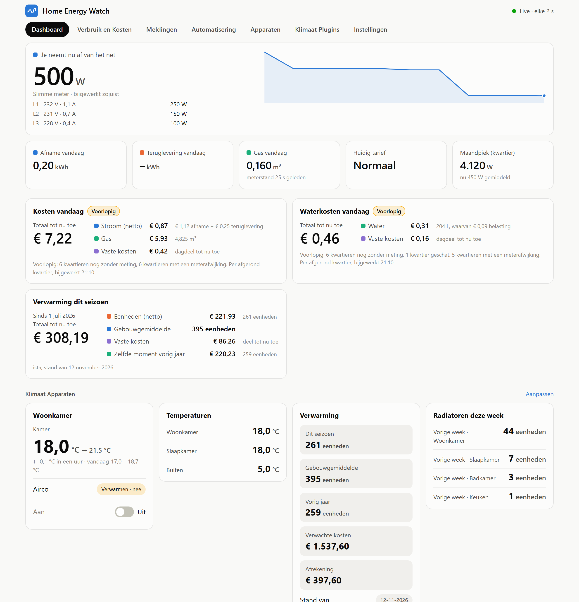
</picture>

</div>

---

## Waarom Home Energy Watch?

|  |  |
|---|---|
| 🔒 **Alles blijft thuis** | De gateway praat rechtstreeks met je apparaten in je eigen netwerk. Geen account, geen cloud, geen abonnement. Je gegevens staan in één SQLite-bestand op je eigen computer. |
| ⚡ **Echt live** | Elke 2 seconden een nieuwe meting, direct op je scherm via een live verbinding. Je ziet de waterkoker aanslaan. |
| 💶 **Weet wat het kost** | Kosten per kwartier, uur, dag, maand en jaar volgens *jouw* contract: dynamisch of vast, met saldering tot 2027 en de regels daarna. Plus een prognose van je jaarafrekening. |
| 📦 **Eén bestand** | Eén programma zonder afhankelijkheden: de app zit erin. Draait op een Windows-pc, een NAS, in Docker of op een Raspberry Pi. |
| 📱 **App op je telefoon** | Installeer het als app op je beginscherm (PWA), met donkere modus en pushmeldingen. |
| 🧩 **Meer dan energie** | Airco's, tado°, Tuya-apparaten en ista-radiatormeters naast je energiemeters, met automatiseringen die alles met elkaar verbinden. |

## Wat kan het?

<table>
<tr>
<td width="50%" valign="top">

### 📊 Live dashboard
Vermogen nu (afname of teruglevering) met spanning, stroom en vermogen per
fase, vandaag-totalen, gas, de piek van de maand, en per apparaat een kaart
met verloop, verbruik en kosten van vandaag. Energy Sockets schakel je met
één tik.

### 📈 Verbruik en historie
Vermogen per minuut, stroom en gas per kwartier, dag, maand en jaar.
Kwartierwaarden worden nauwkeurig berekend uit de meterstanden, met afname
en teruglevering apart. **Importeer** je oude historie uit de HomeWizard-app
(CSV); er wordt nooit iets overschreven of geschat.

### 💶 Kosten, voorschot en "wat als"
Contracten met begin- en einddatum, tariefwijzigingen, stroom en gas bij
verschillende leveranciers, uurprijzen of kwartierprijzen. Je ziet wat je
betaald hebt, wat het kostte, wat je bij de afrekening terugkrijgt of
bijbetaalt, en welk voorschot je nodig hebt. Vergelijk je contract met
**scenario's**: wat had een vast contract gekost, en wat verandert er in
2027 zonder saldering?

</td>
<td width="50%" valign="top">

### 🏷️ Dynamische prijzen
Day-ahead-stroomprijzen per kwartier en de gasprijs per gasdag, voor vandaag
en morgen, als kale marktprijs of als wat *jij* betaalt (met opslag,
energiebelasting en btw). Bronnen: EnergyZero, Nord Pool en ENTSO-E.

### 🔔 Meldingen en ⚙️ automatisering
Pushmeldingen op elke waarde: *wasmachine klaar*, *negatieve stroomprijs*,
*veel gas vandaag*, *apparaat offline*. Automatiseringen schakelen sockets,
bedienen airco's en thermostaten en kiezen de stand van de **thuisbatterij**
(bijvoorbeeld alleen laden in de goedkoopste uren) op basis van verbruik,
temperatuur, tijd en prijs, met **wachtstappen** en **regelen** naar een
doeltemperatuur. Of start ze zelf als **handmatige actie** met een
schakelaar of knop op het dashboard, bijvoorbeeld om meerdere apparaten
tegelijk te bedienen.

### 🌡️ Klimaat, water en verwarming
Plugins voor **Mitsubishi Heavy**-airco's (WF-RAC), **tado°**,
**Tuya / Smart Life** en **ista**-radiatormeters, met bediening, historie,
gekoppelde stroommeters en eigen dashboardtegels. Waterverbruik en
waterkosten (met de 300 m³-grens van de belasting), en verwarmingsverbruik
per kamer met de kosten volgens je ista-afrekening.

### 🔌 Netkwaliteit en storingen
Spanning, stroom en vermogen per fase per minuut, plus de spanningsdips,
-pieken en stroomstoringen die je slimme meter telt. Per apparaat zie je hoe
vaak en hoe lang het niet bereikbaar was; een belletje meldt nieuwe storingen
en problemen, zoals een rapport dat niet gemaild kon worden.

### 📄 Rapporten
Een PDF met grafieken over elke periode: verbruik, dagprofiel en
sluipverbruik, kosten en hun opbouw, water en verwarming, per apparaat
(ook per radiator), scenario's, netkwaliteit en voorschot. Download hem in de app of laat hem elke maand of
week **mailen** via je eigen mailserver.

</td>
</tr>
</table>

## Een rondleiding

### Verbruik en Kosten

Eén tabblad voor energie, water en verwarming: kies het apparaat, de periode
(vandaag tot en met *alles*, of precies je contractperiode) en de weergave.

<p align="center">
  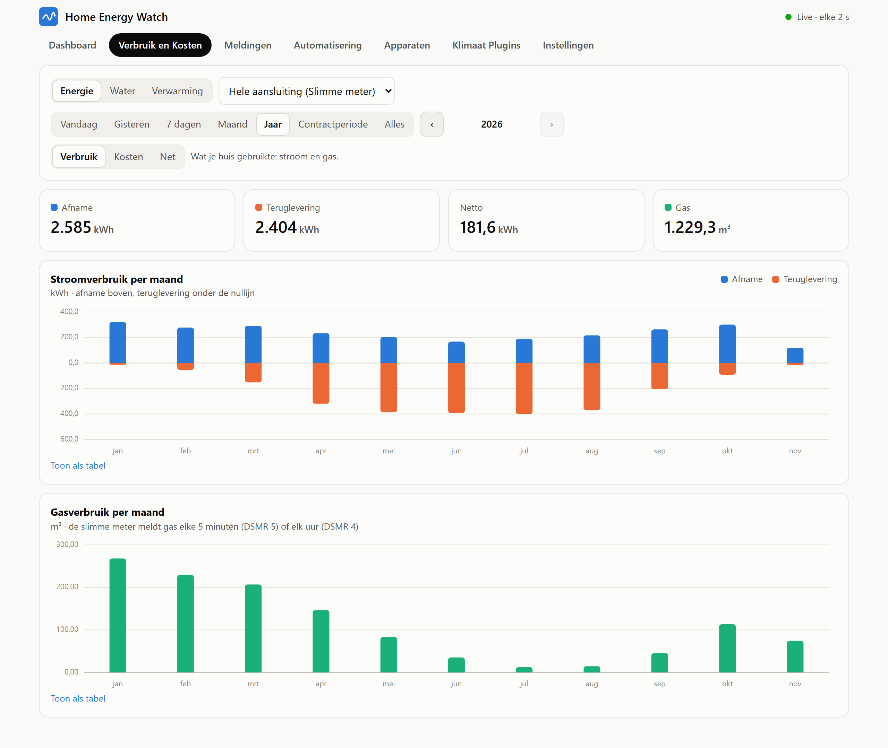
</p>

<p align="center">
  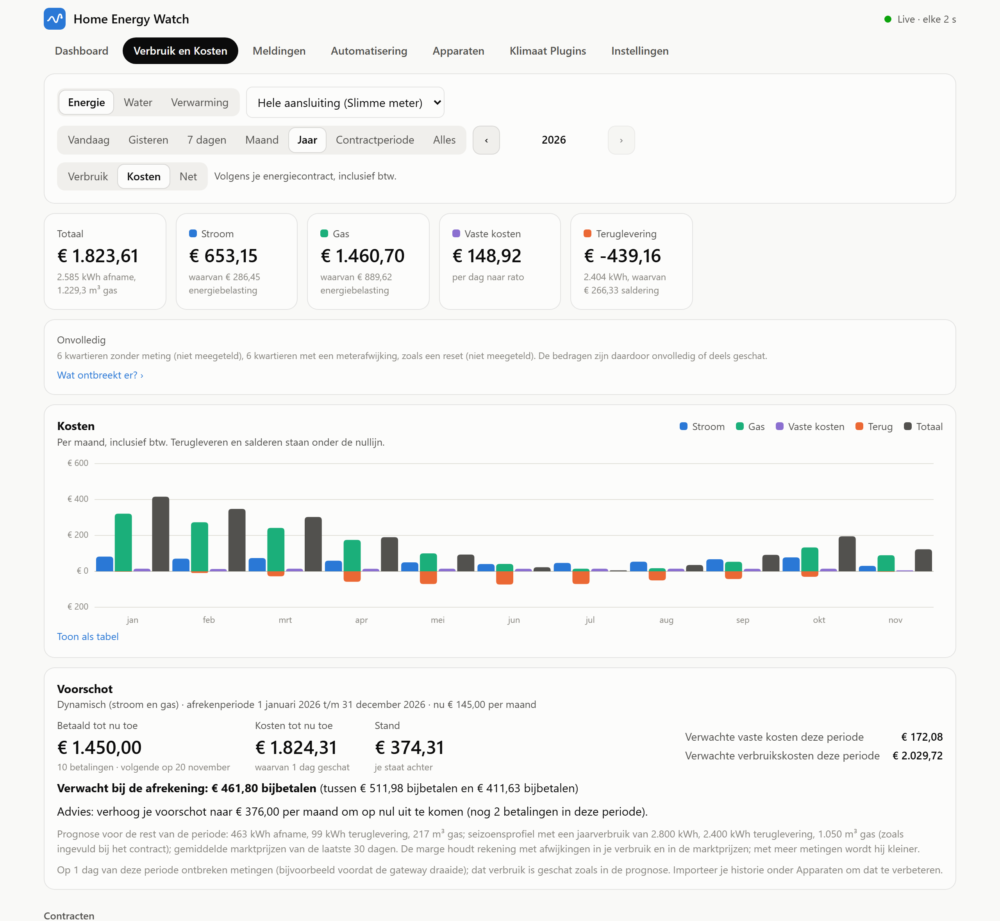
</p>

<table>
<tr>
<td width="50%">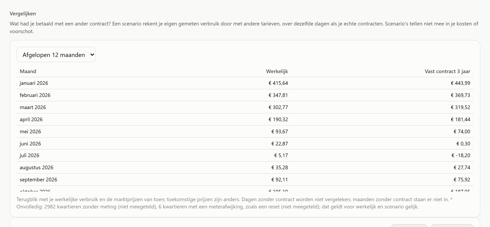</td>
<td width="50%">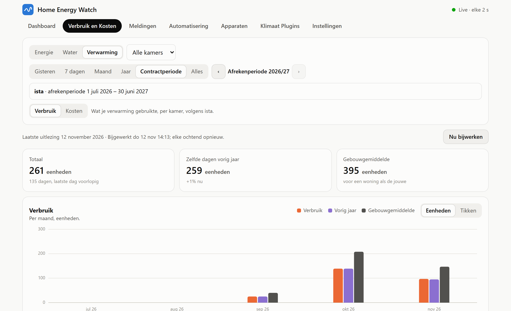</td>
</tr>
<tr>
<td align="center"><b>Vergelijken</b>: je eigen verbruik doorgerekend met een ander contract</td>
<td align="center"><b>Verwarming</b>: per kamer, tegenover vorig jaar en het gebouw</td>
</tr>
</table>

### Klimaat en automatisering

<table>
<tr>
<td width="50%">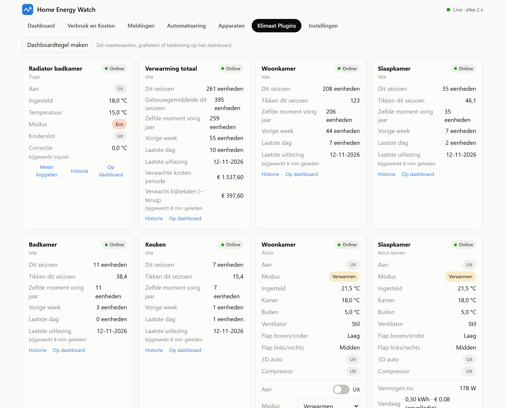</td>
<td width="50%">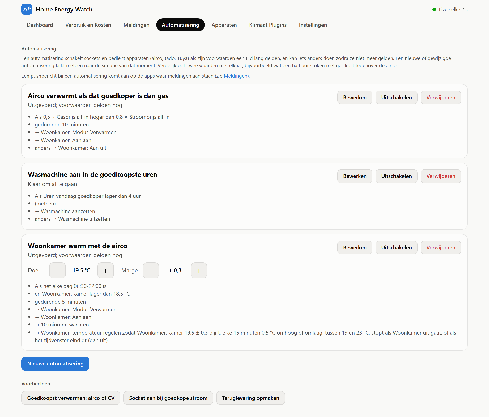</td>
</tr>
<tr>
<td align="center"><b>Klimaat Plugins</b>: uitlezen, bedienen en meters koppelen</td>
<td align="center"><b>Automatisering</b>: voorwaarden, wachtstappen en regelen</td>
</tr>
<tr>
<td width="50%">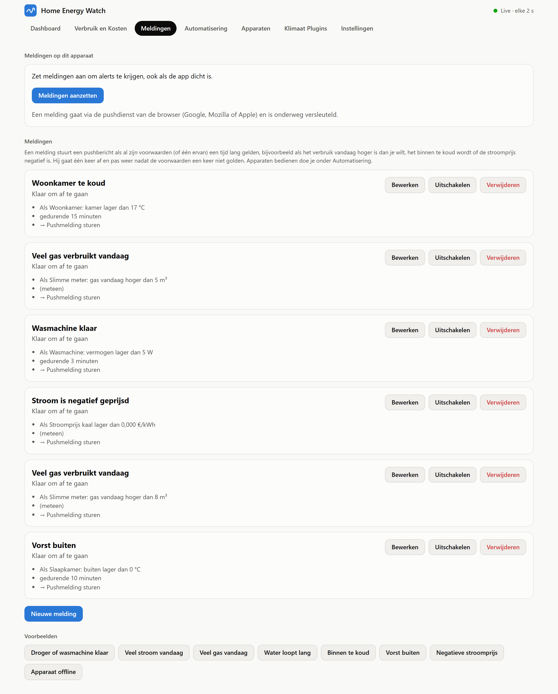</td>
<td width="50%">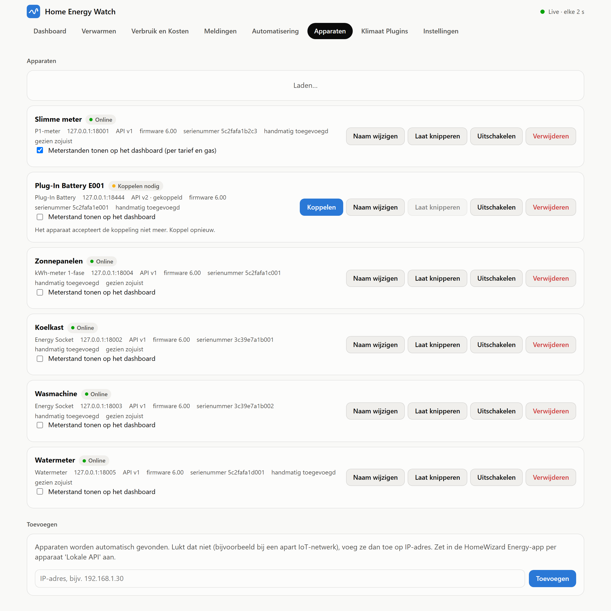</td>
</tr>
<tr>
<td align="center"><b>Meldingen</b>: pushberichten, ook als de app dicht is</td>
<td align="center"><b>Apparaten</b>: automatisch gevonden via mDNS</td>
</tr>
</table>

### Op je telefoon

Installeer de app op je beginscherm. De tabbladen lopen door over meerdere
regels, dus er hoeft nooit opzij gescrold te worden. Licht of donker volgt je
telefoon.

<p align="center">
  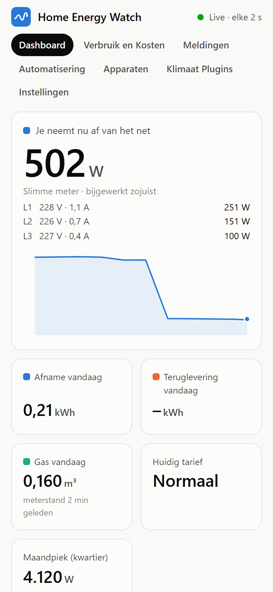
  &nbsp;
  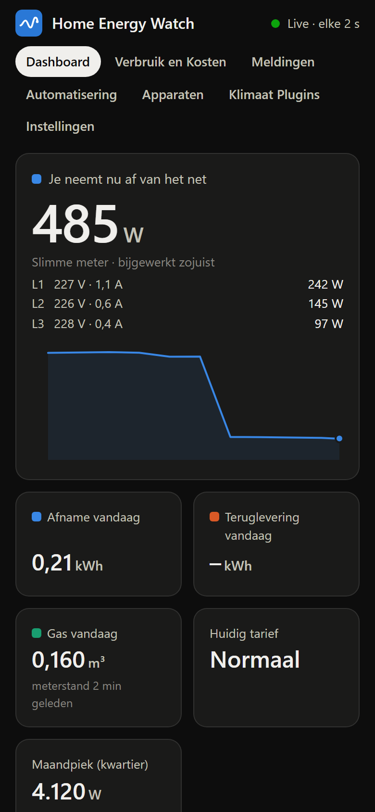
  &nbsp;
  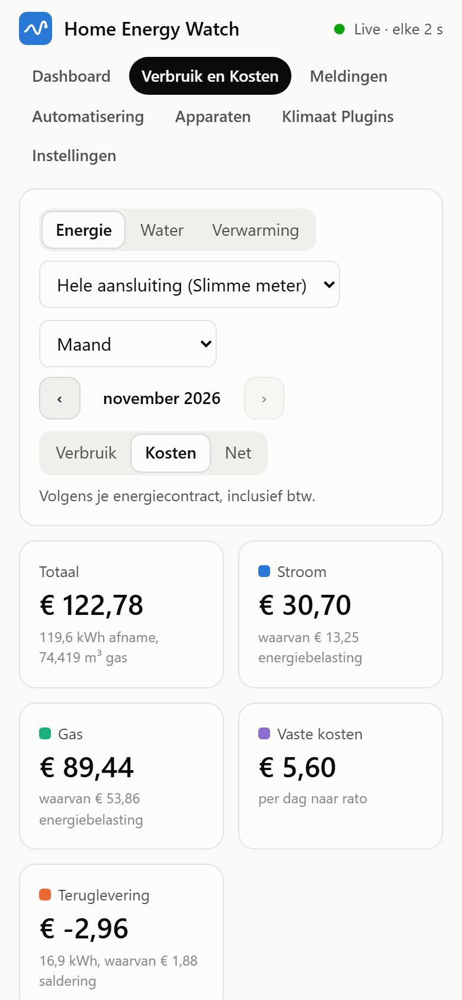
</p>

> De schermafbeeldingen zijn gemaakt met de meegeleverde simulator
> (`hwsim`) en voorbeeldgegevens; de bedragen zijn geen echte rekening. Elk
> scherm stap voor stap staat in de
> [gebruikshandleiding](docs/GEBRUIKSHANDLEIDING.md).

## Installeren

Home Energy Watch is één programma (`hwlocal`). Start het op een computer
die altijd aan staat in hetzelfde netwerk als je HomeWizard-apparaten, en
open daarna `http://<computer>:8080` op je telefoon of pc.

| Platform | Hoe | Start automatisch |
|---|---|---|
| 🪟 **Windows** 10/11 | installer `hwlocal-setup-<versie>.exe` | ✅ als Windows-dienst |
| 🐧 **Linux** (server, NAS, mini-pc) | één bestand + systemd | ✅ |
| 🐳 **Docker** (Synology, QNAP, Unraid, …) | `docker compose` | ✅ |
| 🍓 **Raspberry Pi** 3/4/5 | één bestand (arm64 of armv7) + systemd | ✅ |

Zet eerst in de **HomeWizard Energy-app** per apparaat *Instellingen →
Meters → (apparaat) → Lokale API* aan. Apparaten worden daarna vanzelf
gevonden; staan ze in een ander netwerkdeel (VLAN), voeg ze dan toe op
IP-adres.

### Windows

1. Download `hwlocal-setup-<versie>.exe` bij de
   [Releases](https://github.com/bytebanger-nl/HomeEnergyWatch/releases), of bouw
   hem zelf met `installer\build.ps1`.
2. Start de installer en kies de poort en eventueel HTTPS. Home Energy Watch
   draait daarna als Windows-dienst: start mee met de pc, ook zonder dat
   iemand is ingelogd, en herstart zichzelf bij een fout.
3. Open **Home Energy Watch** in het Startmenu.

Bijwerken = de nieuwe installer starten; je instellingen en gegevens blijven
staan. Verandert de database, dan maakt Home Energy Watch eerst een kopie.

### Linux en NAS

```bash
CGO_ENABLED=0 GOOS=linux GOARCH=amd64 go build -o hwlocal ./cmd/hwlocal
sudo useradd --system --home /var/lib/hwlocal --create-home hwlocal
sudo cp hwlocal /usr/local/bin/
sudo cp deploy/hwlocal.service /etc/systemd/system/
sudo systemctl enable --now hwlocal
```

### Docker

```bash
git clone https://github.com/bytebanger-nl/HomeEnergyWatch.git
cd HomeEnergyWatch/deploy
docker compose up -d --build
```

De container gebruikt `network_mode: host`, zodat apparaten via mDNS
gevonden worden. Gegevens staan in `deploy/data`.

### Raspberry Pi

Bouw op je pc (Windows, Linux of macOS) een versie voor de Pi en kopieer die
erheen; de Pi zelf hoeft niets te bouwen.

| Raspberry Pi OS | Bouwen |
|---|---|
| 64-bit (Pi 3/4/5) | `CGO_ENABLED=0 GOOS=linux GOARCH=arm64 go build -o hwlocal ./cmd/hwlocal` |
| 32-bit | `CGO_ENABLED=0 GOOS=linux GOARCH=arm GOARM=7 go build -o hwlocal ./cmd/hwlocal` |

Installeer daarna met dezelfde systemd-stappen als bij
[Linux](#linux-en-nas). Er is niets anders nodig: ook de database zit in het
programma.

### Overal bereikbaar en als app

Een app op je beginscherm en pushmeldingen vragen om **HTTPS**. Kies wat bij
je past:

- **Tailscale**: zet in de app Tailscale Serve aan op een poort naar keuze
  (de gateway controleert of die vrij is) en je hebt een geldig https-adres,
  thuis en onderweg, zonder poort in je router.
- **Eigen domein**: een Let's Encrypt-certificaat via Cloudflare
  (DNS-challenge, de gateway hoeft niet vanaf internet bereikbaar te zijn).
- **Eigen certificaat**: de gateway maakt zelf een CA die je eenmalig op je
  apparaten installeert.

Alles staat stap voor stap in de [handleiding](docs/HANDLEIDING.md#https-en-installeren-als-app).

## Ondersteunde apparaten

| Apparaat | Type | Wat je krijgt |
|---|---|---|
| P1-meter | `HWE-P1` | net, per fase, tarieven, gas, netkwaliteit |
| Energy Socket | `HWE-SKT` | verbruik en kosten per apparaat, schakelen |
| kWh-meter | `HWE-KWH1`, `HWE-KWH3`, `SDM230-wifi`, `SDM630-wifi` | bijvoorbeeld zonnepanelen, laadpaal, warmtepomp |
| Watermeter | `HWE-WTR` (met USB-voeding) | verbruik, lekken, waterkosten |
| Plug-In Battery | `HWE-BAT` | laden, ontladen, laadniveau (API v2) |

API v1 werkt zonder koppelen; voor API v2 (zoals de batterij) druk je één
keer op de knop van het apparaat. Het HTTPS-certificaat van het apparaat
wordt gecontroleerd tegen de CA van HomeWizard.

**Plugins** voor andere apparaten:

| Plugin | Verbinding |
|---|---|
| Mitsubishi Heavy Industries-airco's (WF-RAC-wifimodule) | lokaal |
| Tuya / Smart Life (bijv. elektrische radiatoren) | lokaal; bij het scannen worden de sleutels eenmalig uit je Tuya IoT-project gehaald |
| tado° | via de tado-cloud (tado heeft geen lokale API) |
| ista (radiatormeters) | via mijn.ista.nl |

## Hoe het werkt

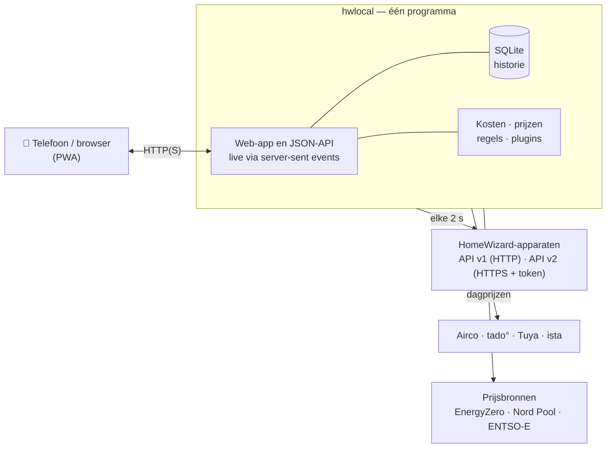

- Apparaten worden gevonden via mDNS en elke 2 seconden uitgelezen.
- Metingen gaan naar de historie (per minuut, en kwartierwaarden voor
  altijd) en live naar elke geopende app.
- Van internet komen alleen de energieprijzen, en wat je zelf aanzet:
  pushmeldingen, tado°, ista en het scannen van Tuya-apparaten.

### Veilig standaard

- Alleen apparaten in je eigen netwerk krijgen antwoord; voor onderweg
  gebruik je Tailscale in plaats van een open poort.
- Bescherming tegen verzoeken van andere websites (CSRF) en tegen
  *DNS rebinding*.
- Tokens van apparaten worden nooit teruggegeven; wachtwoorden en sleutels
  van plugins staan versleuteld (AES-256-GCM) in de database.
- Bediening van airco's en thermostaten staat uit tot je die per plugin
  aanzet.
- Elke nacht een back-up van de database, de sleutels en de instellingen;
  terugzetten of verhuizen naar een andere computer met `hwlocal restore`.
- Optioneel een wachtwoord voor de app en de API, met per browser een
  sessie die blijft zolang je hem gebruikt, en API-tokens (alleen lezen of
  ook bedienen) voor scripts en koppelingen.

## Documentatie

| | |
|---|---|
| 🧭 [Gebruikshandleiding](docs/GEBRUIKSHANDLEIDING.md) | elk scherm met schermafbeeldingen: wat je ziet en hoe je het gebruikt |
| 📖 [Handleiding](docs/HANDLEIDING.md) | alles over instellen, importeren, prijzen, kosten, plugins, meldingen, HTTPS, configuratie, de API en bekende beperkingen |
| 💶 [Energiecontracten](docs/CONTRACTS.md) | het kostenmodel: salderen, voorschot, prognose, scenario's |
| 🧩 [Plugins](docs/PLUGINS.md) | ontwerp en protocollen van de airco-, tado-, Tuya- en ista-plugins |
| 🔥 [ista](docs/ISTA.md) | verwarmingsverbruik en -kosten via mijn.ista.nl |
| 🏠 [Kamersimulatie](docs/KAMERSIMULATIE.md) | automatiseringen veilig testen tegen een gesimuleerde kamer |

## Zelf bouwen en meedoen

Nodig: [Go 1.26 of nieuwer](https://go.dev/dl/). Geen C-compiler, geen
Node.js, geen bouwstap voor de app.

```bash
go run ./cmd/hwsim        # gesimuleerde P1, sockets, kWh-meter, water, batterij, airco, prijzen
scripts/dev-sim.sh        # of: simulator + gateway in één keer
go test ./...
```

Open daarna <http://localhost:8080>. Met `scripts/linux-smoke.sh` test je de
Linux-, NAS- en Raspberry Pi-builds tegen de simulator (ARM via QEMU). Meer
in de [handleiding](docs/HANDLEIDING.md#snel-starten-op-je-ontwikkel-pc).

## Licentie

[MIT](LICENSE): vrij te gebruiken, aan te passen en te delen, ook
commercieel, zolang de licentietekst erbij blijft. Zonder garantie.

---

<sub>Home Energy Watch is een onafhankelijk project, niet verbonden aan of
goedgekeurd door HomeWizard. HomeWizard is een merk van de eigenaar ervan.
Het programma, de dienst en de mappen heten technisch `hwlocal`.</sub>
