# Home Energy Watch — gebruikshandleiding

Deze handleiding laat per scherm zien wat je ziet en hoe je het gebruikt. Hoe
je Home Energy Watch installeert en instelt staat in de
[README](../README.md#installeren); de technische naslag (instellingen, API,
beveiliging) in de [handleiding](HANDLEIDING.md).

> De schermafbeeldingen komen uit de simulator met voorbeeldgegevens. Bij jou
> staan je eigen apparaten, bedragen en namen.

**Inhoud**

1. [Eerste keer openen](#1-eerste-keer-openen)
2. [Dashboard](#2-dashboard)
3. [Verbruik en Kosten](#3-verbruik-en-kosten)
4. [Contracten, voorschot en vergelijken](#4-contracten-voorschot-en-vergelijken)
5. [Water en verwarming](#5-water-en-verwarming)
6. [Meldingen](#6-meldingen)
7. [Automatisering](#7-automatisering)
8. [Apparaten](#8-apparaten)
9. [Klimaat Plugins](#9-klimaat-plugins)
10. [Instellingen](#10-instellingen)
11. [Op je telefoon](#11-op-je-telefoon)

---

## 1. Eerste keer openen

Open in een browser op je computer of telefoon het adres van de gateway,
bijvoorbeeld `http://192.168.1.20:8080` (op de computer waar hij draait ook
`http://localhost:8080`). Er is geen account en geen wachtwoord: iedereen in
je thuisnetwerk kan de app openen.

1. **Lokale API aanzetten.** Zet in de HomeWizard Energy-app per apparaat
   *Lokale API* aan. De gateway vindt de apparaten daarna vanzelf in je
   netwerk; ze verschijnen binnen een minuut op het dashboard.
2. **Niet gevonden?** Voeg het apparaat toe op IP-adres onder
   [Apparaten](#8-apparaten), bijvoorbeeld als je apparaten op een apart
   IoT-netwerk staan.
3. **Plug-In Battery** (en andere apparaten met de nieuwe API) moet je eenmalig
   **koppelen**: klik op *Koppelen* en druk binnen anderhalve minuut op de knop
   van het apparaat.
4. **Je contract invoeren** maakt de kosten compleet: zie
   [Contracten](#4-contracten-voorschot-en-vergelijken).
5. **Historie die je al hebt** (uit de HomeWizard Energy-app) kun je
   importeren onder [Instellingen](#10-instellingen).

Bovenaan staat altijd de verbinding: *Live · elke 2 s* met een groene stip
betekent dat de gegevens binnenkomen.

---

## 2. Dashboard

Het dashboard is het beginscherm: wat er nu gebeurt en wat het vandaag kost.

### Nu en vandaag

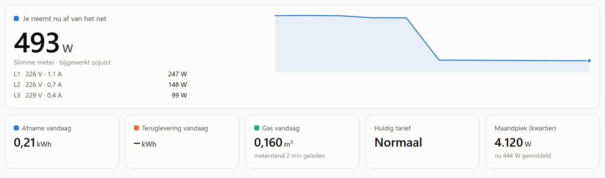

- **Je neemt nu af van het net** (of *Je levert nu terug*): het vermogen van
  de slimme meter, elke 2 seconden bijgewerkt, met per fase de spanning, de
  stroom en het vermogen. De lijn rechts toont de laatste 10 minuten.
- **Afname / Teruglevering / Gas vandaag**: sinds middernacht.
- **Huidig tarief**: *Normaal* of *Dal* volgens de slimme meter.
- **Maandpiek (kwartier)**: het hoogste kwartiergemiddelde van deze maand, en
  wat het lopende kwartier tot nu toe gemiddeld is.

### Berichten (het belletje)

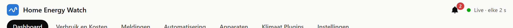

Is er iets dat je aandacht vraagt, dan staat rechtsboven een belletje met
het aantal. Het is er alleen zolang er iets ongelezen is. Klik erop voor
**Berichten**:

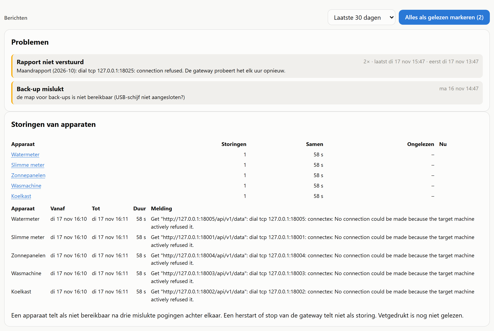

- **Problemen**: bijvoorbeeld een rapport dat niet gemaild kon worden, een
  mislukte back-up, een automatisering die een apparaat niet kon bedienen, of
  ista die het inloggen weigert.
- **Storingen van apparaten**: welke apparaten niet bereikbaar waren, hoe
  vaak en hoe lang. Klik op een apparaat om alleen zijn storingen te zien.

Met **Alles als gelezen markeren** verdwijnt het belletje, ook op je andere
apparaten. Een herstart van de gateway telt niet als storing, en prijzen of
ista-gegevens die nog niet binnen zijn ook niet: die komen vanzelf.

### Kosten van vandaag

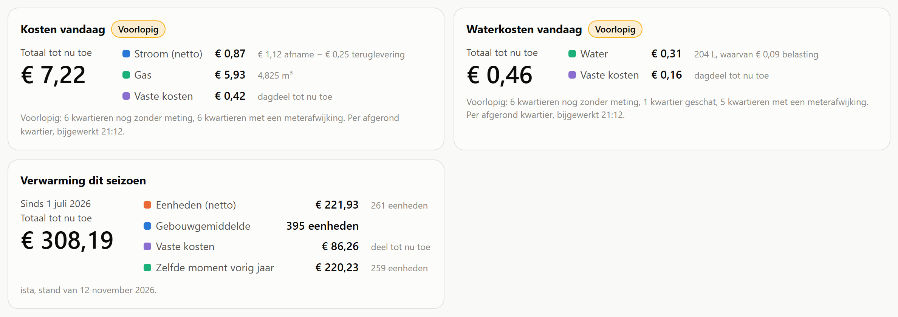

- **Kosten vandaag**: stroom (afname min teruglevering), gas en het deel van de
  vaste kosten tot nu toe, volgens je contract. *Voorlopig* betekent dat er
  nog kwartieren ontbreken of geschat zijn; de tekst eronder zegt welke. Het
  laatste uur telt daarbij nog niet mee: die kwartieren kunnen nog aangevuld
  worden. Ook de tijd voordat de gateway begon te meten telt niet als
  ontbrekend.
- **Waterkosten vandaag**: alleen met een watermeter en een watercontract.
- **Verwarming dit seizoen**: alleen met de ista-plugin. Wat de verwarming
  sinds het begin van de afrekenperiode heeft gekost, naast het
  gebouwgemiddelde en hetzelfde moment vorig jaar.

### Energieprijzen

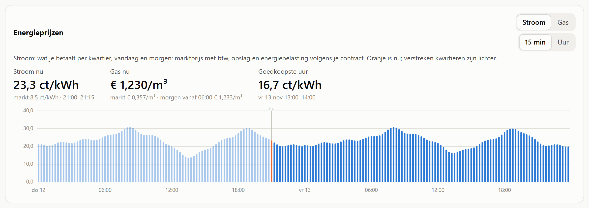

De stroomprijs per kwartier voor vandaag en, vanaf ongeveer 13:00, morgen. Het
huidige kwartier is oranje, verstreken kwartieren zijn lichter. Met een
contract ingevoerd is dit wat jij betaalt (marktprijs met btw, opslag en
energiebelasting); zonder contract de kale marktprijs.

- **Stroom / Gas** wisselt tussen de stroomgrafiek en de gasprijs per gasdag
  (06:00 tot 06:00).
- **15 min / Uur**: rekent je leverancier per uur af, kies dan *Uur*; de app
  begint met wat je bij je contract hebt gekozen.
- **Goedkoopste uur**: alleen bij een dynamisch stroomcontract.

### Apparaten

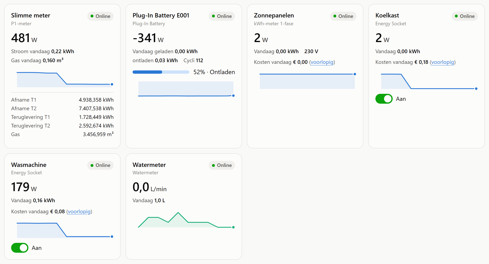

Onderaan een kaart per apparaat met het vermogen nu en het verbruik van
vandaag. Bij tussenstekkers (Energy Sockets) en kWh-meters staat ook wat dat
vandaag kost; klik op *(voorlopig)* voor de uitleg. Een tussenstekker zet je
hier aan en uit met de schakelaar. De meterstanden per tarief zet je per
apparaat aan onder [Apparaten](#8-apparaten).

### Eigen tegels (Klimaat Apparaten)

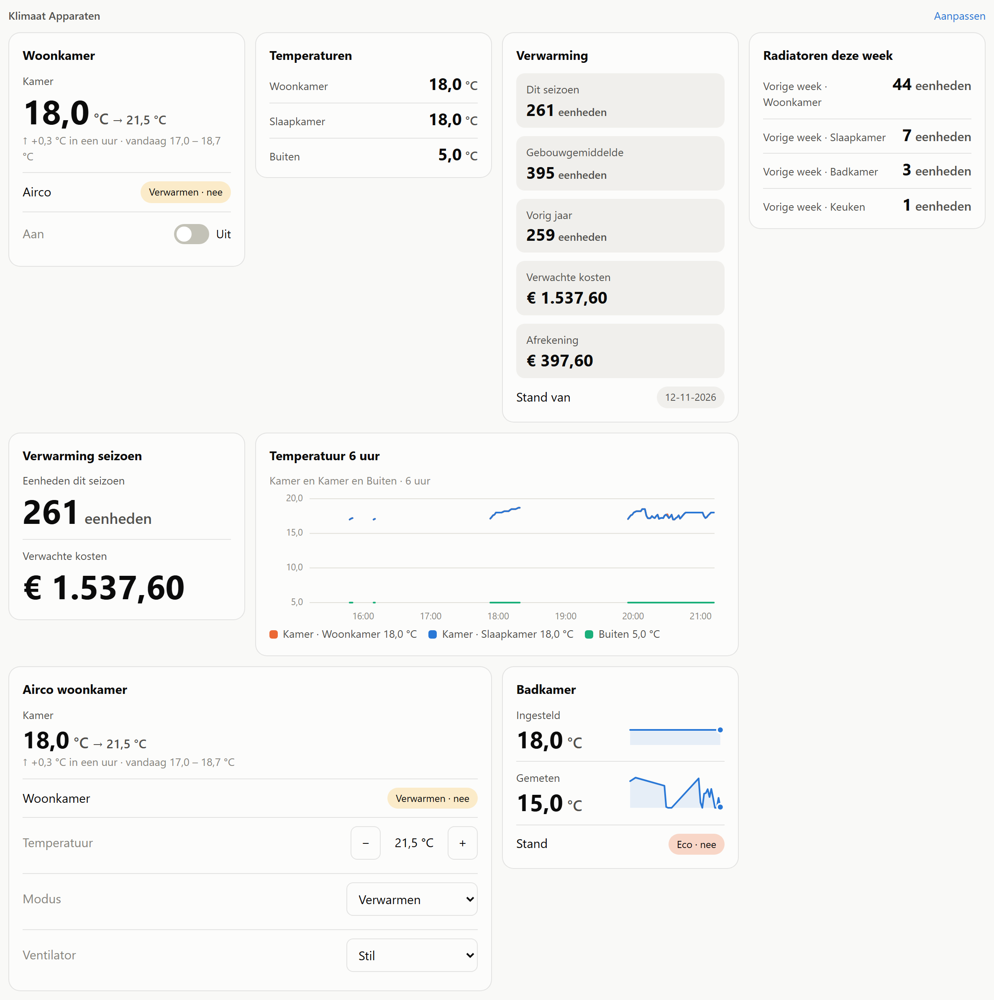

Heb je plugins (airco, tado, Tuya, ista), dan maak je eigen tegels voor het
dashboard: zie [Dashboardtegel maken](#dashboardtegel-maken). Met
**Aanpassen** rechtsboven verander je de volgorde (↑ ↓), bewerk of verwijder
je een tegel en voeg je er een toe. **Klaar** sluit het aanpassen.

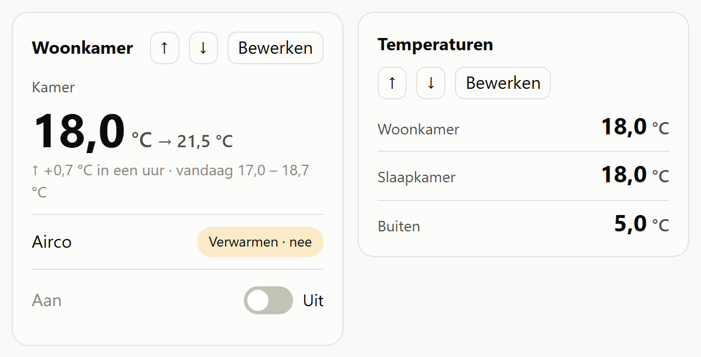

De tegels staan in de gateway, dus je ziet dezelfde op je telefoon, tablet en
computer.

---

## 3. Verbruik en Kosten

Eén tabblad voor alles wat terugkijkt. Bovenaan maak je vier keuzes; ze
gelden voor alles eronder.

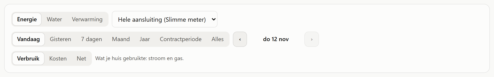

1. **Soort**: *Energie*, *Water* (met een watermeter) of *Verwarming* (met
   ista).
2. **Apparaat**: *Hele aansluiting* (de slimme meter), of één tussenstekker of
   kWh-meter.
3. **Periode**: *Vandaag*, *Gisteren*, *7 dagen*, *Maand*, *Jaar*,
   *Contractperiode* (een contract van begin tot eind) of *Alles*. Met ‹ en ›
   ga je een periode terug of vooruit.
4. **Weergave**: *Verbruik*, *Kosten* of *Net*.

Met **PDF** naast de weergave maak je een rapport over de periode die je
ziet (bij *Water* over het water). Wat er in een rapport staat, lees je in
[Rapporten en e-mail](#rapporten-en-e-mail).

### Verbruik

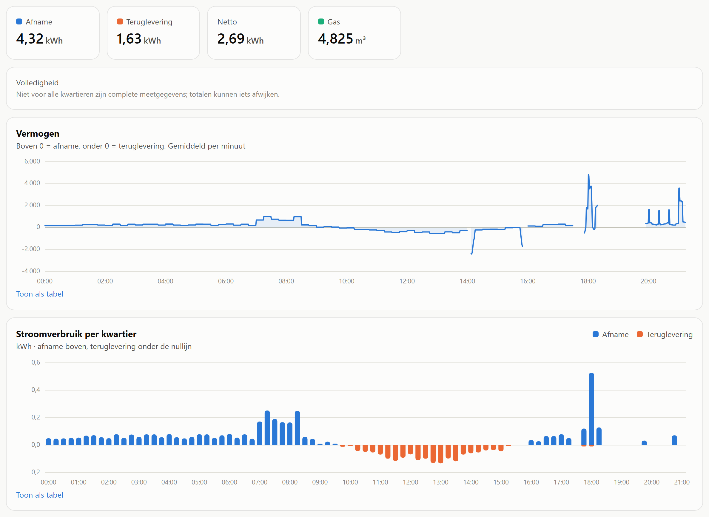

Bovenaan de totalen. Voor één dag zie je daaronder het **vermogen per
minuut** (boven 0 afname, onder 0 teruglevering) en **stroom en gas per
kwartier**. Voor langere perioden staan de staven per dag, maand of jaar:

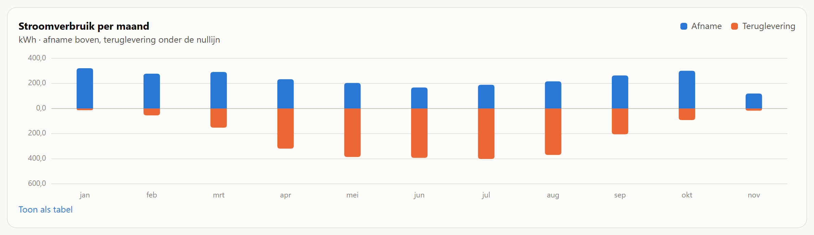

Onder elke grafiek opent **Toon als tabel** de getallen. Beweeg over een
grafiek (of tik erop) voor de waarden van dat moment.

*Volledigheid* (of *Onvolledig* bij kosten) betekent dat niet elk kwartier
compleet gemeten is, bijvoorbeeld omdat de gateway even uit stond.

### Net

Alleen bij de slimme meter en kWh-meters: de spanning, de stroomsterkte en het
vermogen per fase per minuut, en de **netgebeurtenissen** die de slimme meter
telt (spanningsdips, -pieken en stroomstoringen, ook die van toen de gateway
uit stond).

### Kosten

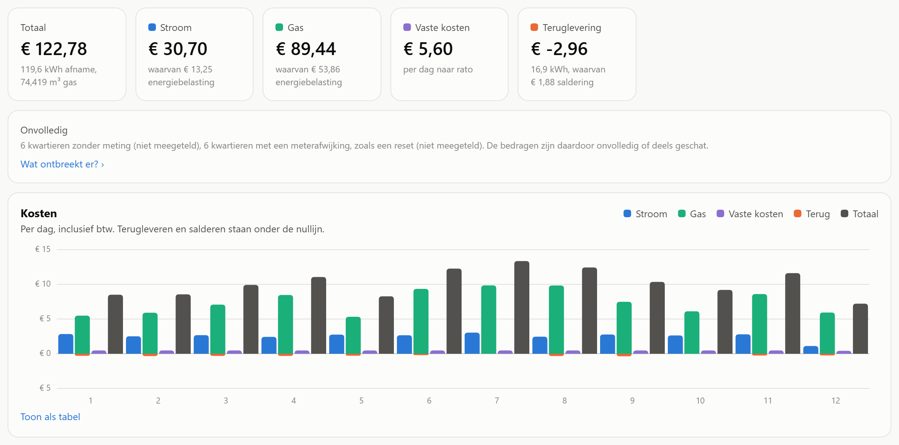

Wat je verbruik kostte volgens je contracten: totaal, stroom (met hoeveel
energiebelasting), gas, vaste kosten en teruglevering (negatief: dat krijg je
terug, met tot en met 2026 het salderen). Per uur voor één dag, anders per
dag, maand of jaar.

Kies je een tussenstekker of kWh-meter als apparaat, dan zie je alleen wat
**dat apparaat** kostte: zijn afname tegen je stroomprijs, zonder vaste kosten.

**Onvolledig.** Klik op de tegel *Onvolledig* om te zien wat er ontbreekt en
wat je eraan kunt doen:

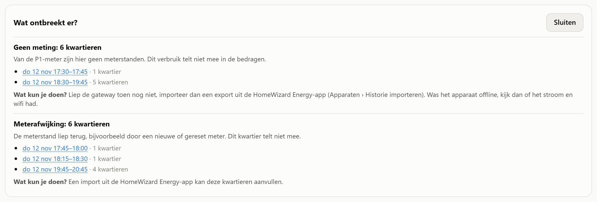

Een periode van één dag is een link naar het verbruik van die dag. Vóór de
eerste meting van een apparaat ontbreekt niets: daar staat alleen wanneer de
metingen beginnen. Eerdere kosten zie je na een import uit de HomeWizard
Energy-app.

---

## 4. Contracten, voorschot en vergelijken

Onder **Verbruik en Kosten → Kosten** staan onder de grafiek je voorschot, je
contracten en de vergelijking met andere contracten.

### Contracten

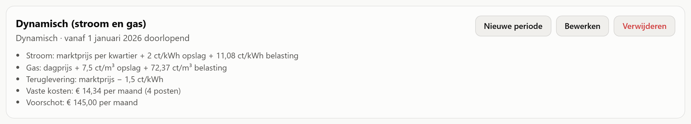

Een contract heeft een begindatum (elke dag kan) en eventueel een einddatum;
zonder einddatum loopt het tot het volgende contract. Alle bedragen zijn
**inclusief btw**, zoals op je contract of jaarnota.

- **Contract toevoegen** voor een nieuw contract, bijvoorbeeld bij een andere
  leverancier: dat begint een eigen afrekenjaar.
- **Nieuwe periode** bij een tariefwijziging bij dezelfde leverancier: een
  kopie met een nieuwe begindatum, die doorloopt in hetzelfde afrekenjaar en
  hetzelfde voorschot.
- **Bewerken** opent het formulier:

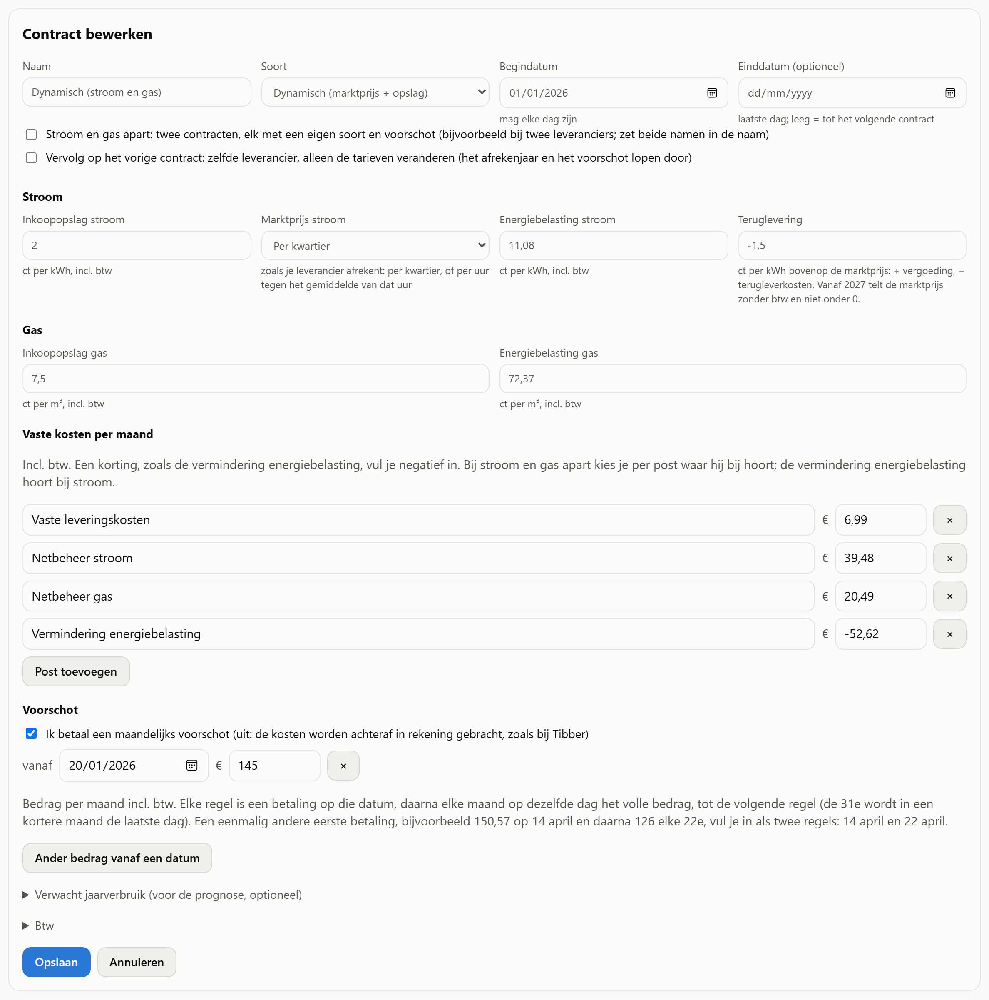

| Veld | Wat vul je in |
|---|---|
| Soort | *Dynamisch* (marktprijs + opslag) of *Vast/variabel* (vaste tarieven, eventueel normaal en dal; dal telt zoals je slimme meter het registreert, dus ook op feestdagen) |
| Stroom en gas apart | aanvinken als stroom en gas een ander soort contract of een andere leverancier hebben; je kiest dan per onderdeel de soort en het voorschot |
| Inkoopopslag / tarief | in cent per kWh of m³, inclusief btw |
| Marktprijs stroom | *Per kwartier* of *Per uur*, zoals je leverancier afrekent |
| Energiebelasting | in cent per kWh en per m³, inclusief btw |
| Teruglevering | vergoeding (+) of terugleverkosten (−) in cent per kWh bovenop de marktprijs |
| Vaste kosten per maand | posten zoals leveringskosten en netbeheer; de vermindering energiebelasting als negatief bedrag |
| Voorschot | het maandbedrag en de dag waarop je betaalt; niet aanvinken als je achteraf betaalt (zoals bij Tibber) |
| Verwacht jaarverbruik | optioneel: helpt de prognose als je net begint of iets verandert (warmtepomp, zonnepanelen) |

### Voorschot

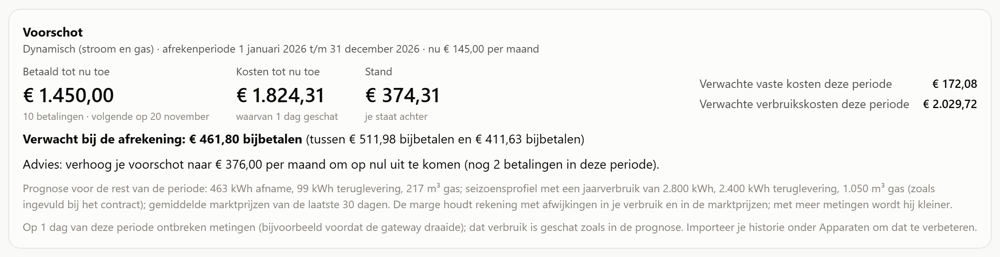

Met een voorschot zie je per afrekenperiode:

- wat je tot nu toe **betaald** hebt en wat het **gekost** heeft, en hoe je
  ervoor staat;
- de **verwachte vaste kosten** en **verbruikskosten** van de hele periode;
- wat je bij de afrekening **verwacht** bij te betalen of terug te krijgen,
  met een marge;
- een **advies** voor het maandbedrag om op nul uit te komen.

De rest van de periode schat de app met het **verwacht jaarverbruik** uit het
contract als je dat invult. Anders volgt hij je verbruik van dezelfde dagen
in de **vorige periode** (de 12 maanden vóór deze afrekenperiode), als daarvan
minstens 90% gemeten of geïmporteerd is; gebruik je tot nu toe stelselmatig
meer of minder, dan houdt hij daar rekening mee. Is er geen van beide, dan
toont de kaart geen prognose maar zegt hij wat er ontbreekt: vul dan het
jaarverbruik in, of importeer je historie (hoofdstuk 10).

Onder de prognose staan de **percentages** waarmee hij rekent, zoals de
marge op je verbruik en, bij een dynamisch contract, op de marktprijzen. Je
ziet of ze berekend zijn uit je metingen, standaard zijn of zelf ingesteld;
met *Aanpassen onder Instellingen* kom je bij de plek waar je ze wijzigt.

### Vergelijken

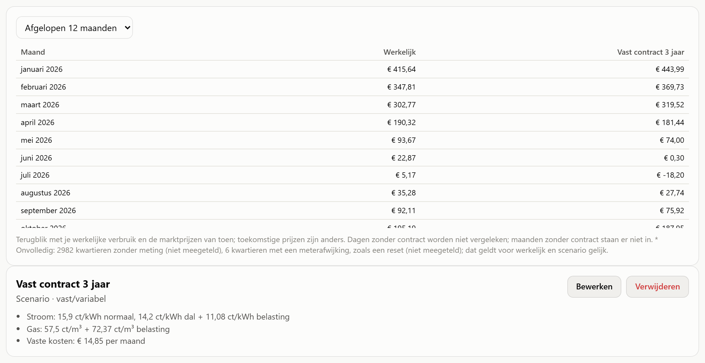

Wat had je betaald met een ander contract? Met **Scenario toevoegen** (of
**Mijn contract als startpunt**) maak je een contract zonder datums met andere
tarieven. Per maand zie je je werkelijke kosten naast die van elk scenario,
en onderaan het verschil. Kies boven de tabel de periode: de afgelopen 12
maanden, dit jaar of vorig jaar. Vink je bij een scenario *Rekenen met de
regels van 2027* aan, dan zie je wat dezelfde periode zonder salderen zou
kosten.

Een scenario is een terugblik met je echte verbruik; het telt nooit mee in je
kosten of voorschot.

---

## 5. Water en verwarming

### Water

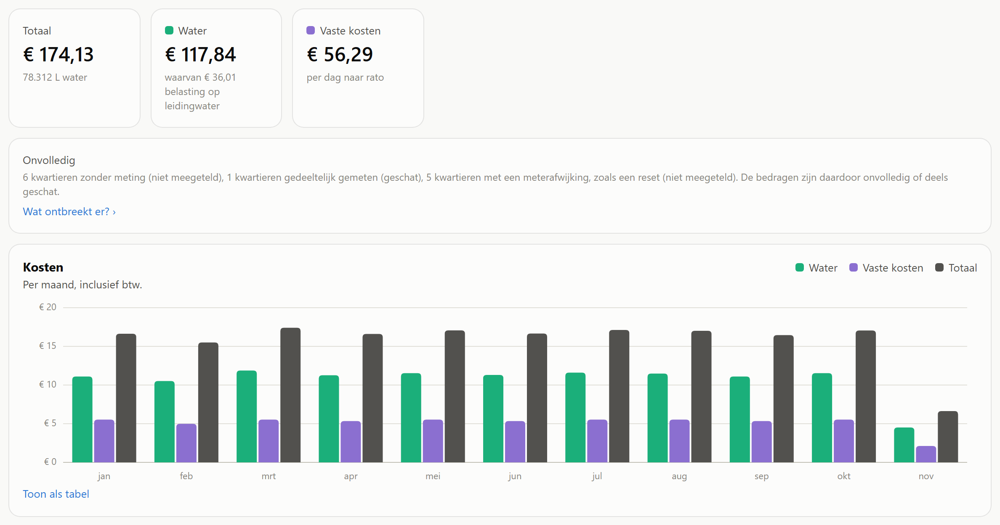

Kies bovenaan *Water*. Water heeft eigen contracten met dezelfde opbouw:
een tarief en de belasting op leidingwater per m³ (die belasting telt over de
eerste 300 m³ per jaar), vastrecht per maand en een voorschot. Rioolheffing en
waterschapsheffing voeg je toe als vaste post als je ze wilt meetellen.

### Verwarming (ista)

Heb je ista-meters op je radiatoren en een account op mijn.ista.nl, voeg dan
de plugin *ista (verwarming)* toe onder [Instellingen](#10-instellingen). Kies
daarna bovenaan *Verwarming*.

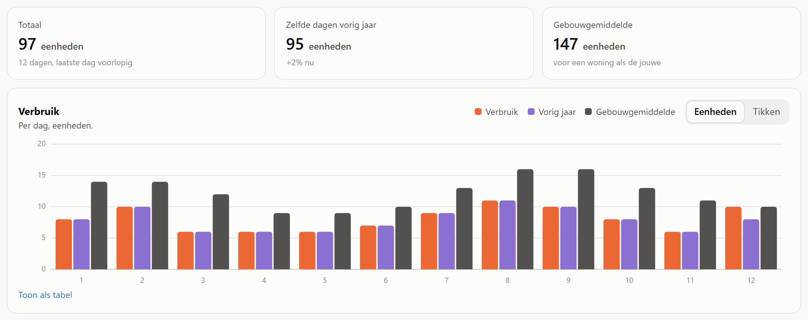

- **Verbruik** in *eenheden* (waarop ista afrekent) of in *tikken* (wat de
  meter telde), naast dezelfde dagen vorig jaar en het gebouwgemiddelde. In
  plaats van een apparaat kies je een kamer, of alle kamers.
- ista heeft alleen dagstanden die achterlopen; *Vandaag* bestaat hier niet.
  De eerste keer ophalen duurt zo'n half uur; daarna werkt de gateway elke
  ochtend bij. **Nu bijwerken** haalt meteen op.
- De app toont alleen wat ista echt gemeten heeft (*Gemeten t/m …*). Heeft
  ista de radiatoren een paar dagen niet uitgelezen, dan tellen die dagen
  nergens mee: niet bij het verbruik, de kosten, het voorschot, het
  gebouwgemiddelde of op het dashboard. Je hoeft niets te doen: zodra ista de
  echte standen heeft, vult de gateway ze vanzelf aan.

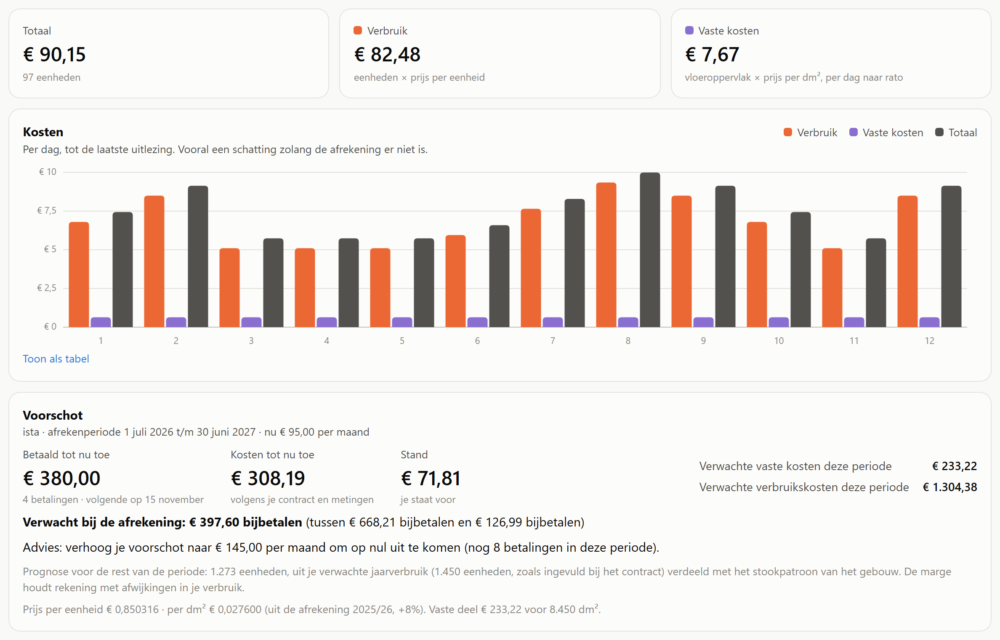

- **Kosten**: voer per afrekenperiode (1 juli tot en met 30 juni) een
  verwarmingscontract in met je vloeroppervlak, je voorschot en, zodra je die
  hebt, de getallen van de jaarafrekening. Neem daarbij de totalen van het
  hele complex over (alle woningen samen), niet de prijzen per eenheid of per
  dm²: die rekent de app zelf uit en laat ze in het formulier zien. Daarna
  toont het contract wat je bijbetaalt of terugkrijgt (afrekening min je
  betaalde voorschot), zodat je dat met de afrekening kunt vergelijken. Tot dan
  rekent de app met de prijzen van de vorige afrekening. De voorschotkaart werkt zoals bij energie.

---

## 6. Meldingen

Een melding stuurt een pushbericht naar je telefoon of computer, ook als de
app dicht is.

### Meldingen aanzetten

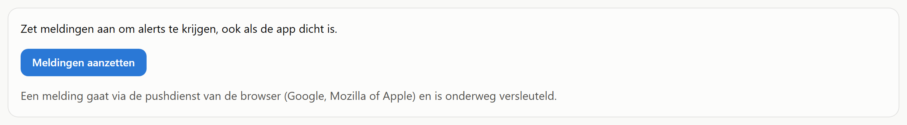

Klik op elk apparaat waarop je meldingen wilt krijgen op **Meldingen
aanzetten**; er komt meteen een testmelding. Dit werkt alleen als de app via
**https** geopend is (zie
[Overal bereikbaar](../README.md#overal-bereikbaar-en-als-app)), en op een
iPhone alleen vanuit de app op het beginscherm (iOS 16.4 of nieuwer).

### Een melding maken

Begin het makkelijkst met een **voorbeeld**; er staan alleen voorbeelden
waarvoor je de apparaten hebt:

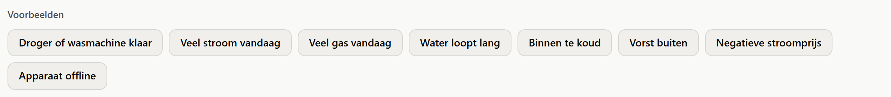

Of klik op **Nieuwe melding**:

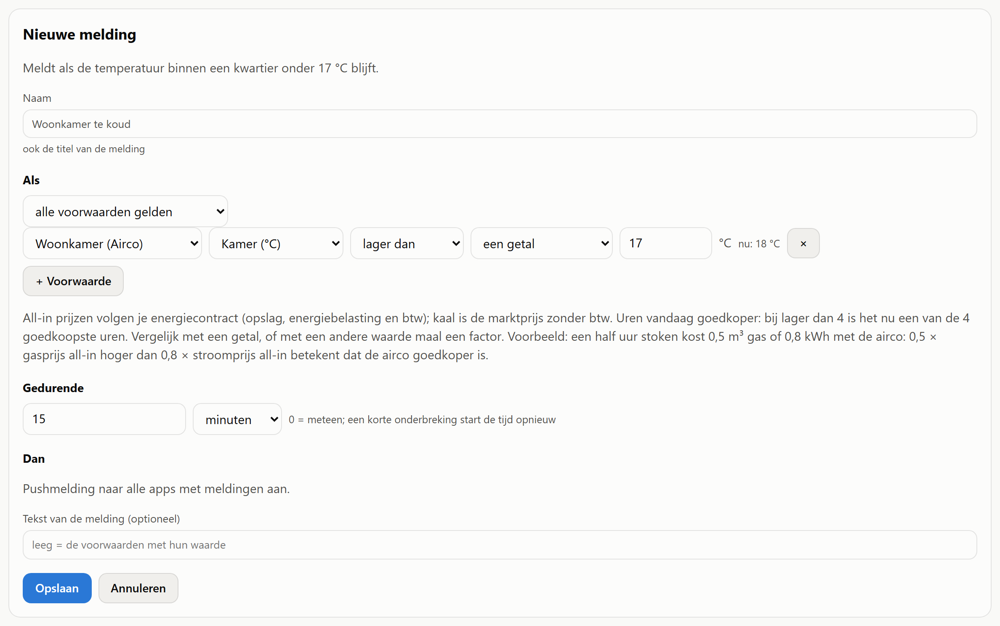

- **Als**: een of meer voorwaarden, die allemaal moeten gelden of waarvan er
  één genoeg is. Een voorwaarde vergelijkt een waarde met een getal of met een
  andere waarde: het vermogen van een apparaat, het verbruik van vandaag, een
  temperatuur, de stroom- of gasprijs (*kaal* of *all-in*), *uren vandaag
  goedkoper*, een tijdvenster, of een apparaat dat offline gaat. Rechts staat
  de waarde van nu.
- **Gedurende**: zo lang moet het onafgebroken gelden; 0 is meteen.
- **Dan**: de pushmelding, met eventueel een eigen tekst.

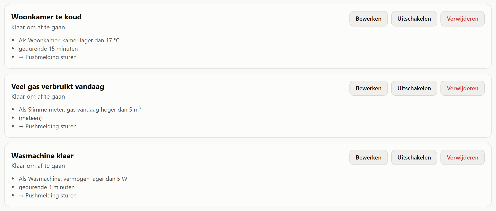

Een melding gaat **één keer** af en pas weer nadat de voorwaarden een keer
niet golden. Zo meldt *Wasmachine klaar* alleen na een wasbeurt en niet de
hele dag dat de wasmachine uit staat. Op de kaart staat de stand (*Klaar om
af te gaan*, *Voorwaarden gelden; wacht tot ze een keer niet gelden*) en
wanneer hij het laatst afging.

---

## 7. Automatisering

Een automatisering doet iets: een tussenstekker aan- of uitzetten, een airco,
tado of Tuya-apparaat bedienen, eventueel met een pushmelding. Ze werkt zoals
een melding (voorwaarden, gedurende), met acties in plaats van alleen een
bericht. Haar pushmelding is kort: de naam van de automatisering en de reden,
zoals *Afgegaan.*, *Bijgeregeld van 21 °C naar 21,5 °C.* of *Gestopt.*

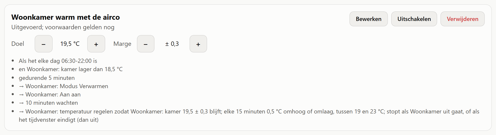

Een **nieuwe** automatisering kijkt meteen naar de situatie van dat moment.
Pas je er een aan die al is afgegaan, dan gaat hij niet opnieuw af: een
wachtstap of het regelen loopt gewoon door met de nieuwe instellingen. Een plugin-apparaat bedienen kan pas als je bij die plugin
*Bediening toestaan* hebt aangezet onder [Instellingen](#10-instellingen).

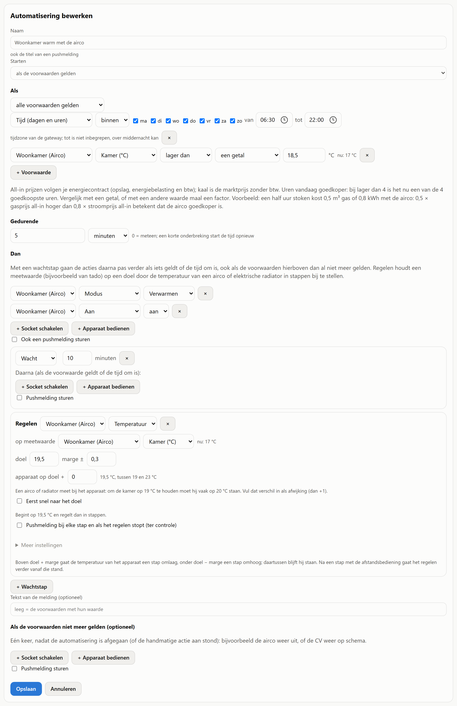

- **+ Socket schakelen** en **+ Apparaat bedienen**: de acties.
- **Als de voorwaarden niet meer gelden**: acties voor daarna, bijvoorbeeld de
  airco weer uit of de CV terug op schema.
- **+ Wachtstap**: wacht tot iets geldt (hooguit een aantal minuten) of een
  vaste tijd, en voer dan de volgende acties uit. Bijvoorbeeld: eerst de CV
  hoger, en als het na 30 minuten nog niet warm genoeg is de airco erbij.
  Gelden de voorwaarden tijdens het wachten niet meer en heeft de
  automatisering acties voor dat geval, dan stopt het wachten: de acties
  daarna gaan niet meer af.
- **Regelen**: houdt een meetwaarde (bijvoorbeeld de kamertemperatuur van tado)
  op een **doel ± marge** door de temperatuur van een airco of elektrische
  radiator elke zoveel minuten een stap omhoog of omlaag te zetten. Met
  *apparaat op doel +* vul je in hoeveel hoger het apparaat moet staan dan
  het doel (een airco aan het plafond staat vaak 1 à 2 graden hoger); onder
  *Meer instellingen* hoe ver hij onder en boven het doel mag (standaard 2,
  dus bij doel 19 tussen 17 en 21 °C; de afwijking verschuift dat niet).
  Zonder boost begint het apparaat op doel + afwijking (bij doel 19 en +1
  dus op 20 °C). Met **Eerst snel naar het doel** gaat het apparaat bij een te koude
  kamer eerst helemaal omhoog (bij te warm helemaal omlaag) en, zodra de kamer
  bijna op het doel is, naar doel + afwijking; daarna regelt hij in stappen.
  Doel en marge pas je daarna op de kaart aan met − en +; het bereik schuift
  mee. Pas je tijdens het regelen de automatisering aan (op de kaart of in
  het formulier), dan gaat het regelen gewoon door met de nieuwe waarden; staat de airco dan buiten het nieuwe bereik, dan zet hij
  die bij de volgende controle erbinnen. Onder *Grafiek van de
  laatste 24 uur* zie je de gemeten temperatuur, de stand van de airco en
  het doel; gekleurd zijn de tijden waarin deze automatisering regelde. De
  grafiek staat alleen bij een automatisering die de laatste 24 uur heeft
  geregeld, niet bij een andere die dezelfde airco gebruikt. Wil je het regelen controleren, zet dan *Pushmelding bij elke
  stap* aan: je krijgt dan een bericht bij elke stap en als het regelen stopt.
  Na elke opdracht aan de airco of tado kijkt de gateway of de nieuwe stand
  is doorgekomen; zo niet, dan probeert hij het nog twee keer. Lukt het dan
  nog niet, dan krijg je een pushmelding.

### Handmatige acties

Kies je in het formulier bij **Starten** *handmatig, vanaf het dashboard*,
dan heeft de automatisering geen voorwaarden: je zet hem zelf aan en uit, op
zijn kaart of op een [dashboardtegel](#dashboardtegel-maken). Zo bedien je
met één schakelaar meerdere apparaten, of laat je de airco de kamer op
temperatuur houden wanneer jij dat wilt. Bijvoorbeeld *Woonkamer warm*: airco
aan en regelen tot de kamer 19 °C is, en **bij uitzetten** de airco weer uit.

- **Aan** doet wat een automatisering doet als ze afgaat: de acties, de
  wachtstap en het regelen. Doel en marge pas je aan met − en + op de
  kaart; op de tegel alleen het doel. **Uit** voert de acties *bij uitzetten* uit en stopt het regelen.
- Heeft de actie niets bij uitzetten, geen wachtstap en geen regelen
  (bijvoorbeeld *Alles uit*: een paar tussenstekkers uit), dan krijg je een
  knop **Uitvoeren** in plaats van een schakelaar.
- De actie gaat vanzelf uit als er niets meer loopt, bijvoorbeeld als je de
  airco met de afstandsbediening uitzet terwijl hij regelt.
- Een actie moet ingeschakeld zijn om te kunnen starten. Kopieer je een
  automatisering en zet je de kopie op *handmatig*, dan staat ze na opslaan
  meteen ingeschakeld. Staat een actie toch uit, dan zegt de tegel dat; klik
  dan **Inschakelen** op de kaart onder Automatisering.
- Stuurt een andere automatisering hetzelfde apparaat, dan geldt wat het
  laatst een opdracht gaf.

**Kopiëren** op een kaart opent het formulier met een kopie, met de naam
plus *Kopie*. Na opslaan staat de kopie uit, zodat ze niet tegelijk met het
origineel hetzelfde apparaat bestuurt; schakel haar in als ze moet gaan
werken.

Voorbeelden die klaarstaan: *Verwarmen: eerst CV, dan airco*, *Airco: snel
opwarmen, dan op temperatuur houden*, *Goedkoopst
verwarmen: airco of CV*, *Socket aan bij goedkope stroom*, *Teruglevering
opmaken* en *Airco uit als het raam open staat*.

> **Tip.** Een vast tijdschema kan je thermostaat (tado) zelf beter, want dat
> werkt ook als de gateway uit staat. Gebruik automatisering voor wat over
> meerdere apparaten of over prijzen gaat.

---

## 8. Apparaten

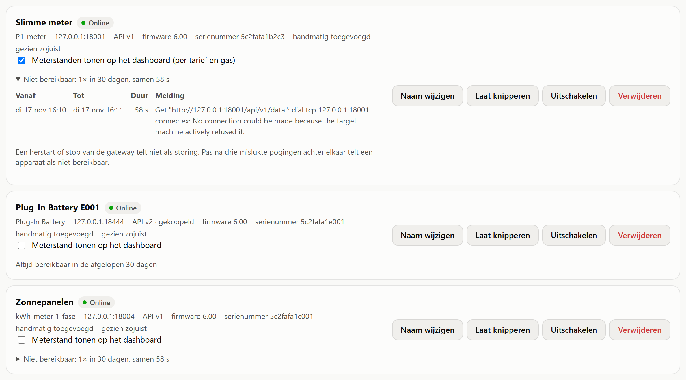

Per apparaat het type, het adres, de API-versie en de firmware, en de knoppen:

- **Naam wijzigen**: de naam die overal in de app staat.
- **Laat knipperen**: het lampje van het apparaat knippert, zodat je ziet welk
  het is.
- **Koppelen**: voor apparaten met de nieuwe API (zie
  [Eerste keer](#1-eerste-keer-openen)).
- **Uitschakelen**: de gateway leest het apparaat niet meer uit; de historie
  blijft.
- **Meterstanden tonen op het dashboard**: zet de tellerstanden per tarief
  (en gas of water) op de kaart van dit apparaat.

Onder de gegevens staat hoe vaak het apparaat de afgelopen 30 dagen **niet
bereikbaar** was en hoe lang samen. Klik erop voor de lijst: wanneer, hoe
lang en met welke foutmelding. Een herstart van de gateway telt niet mee. Bij
plugin-apparaten staat dezelfde regel op hun kaart en onder Instellingen →
Plugins. Alle storingen bij elkaar zie je onder [Berichten](#berichten-het-belletje).

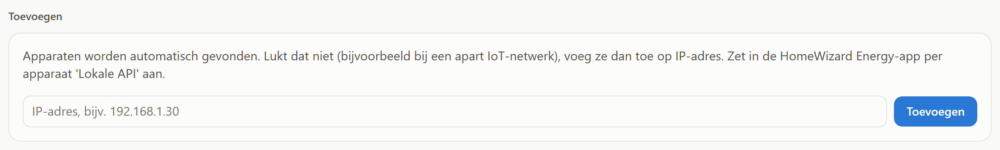

**Toevoegen** op IP-adres als een apparaat niet vanzelf gevonden wordt.

Het importeren van historie, de prijsbronnen, de beveiliging, toegang op
afstand en de versie van de gateway staan onder
[Instellingen](#10-instellingen).

---

## 9. Klimaat Plugins

Dit tabblad verschijnt zodra je een plugin-apparaat hebt (zie
[Instellingen](#10-instellingen)): een tegel per airco, tado-kamer,
Tuya-apparaat, ista-radiator of thuisbatterij.

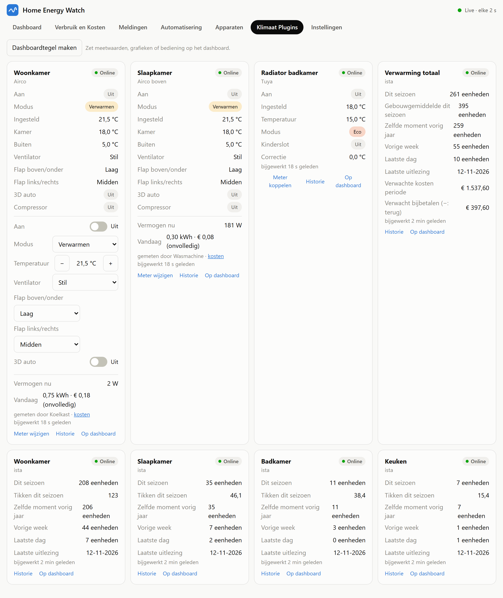

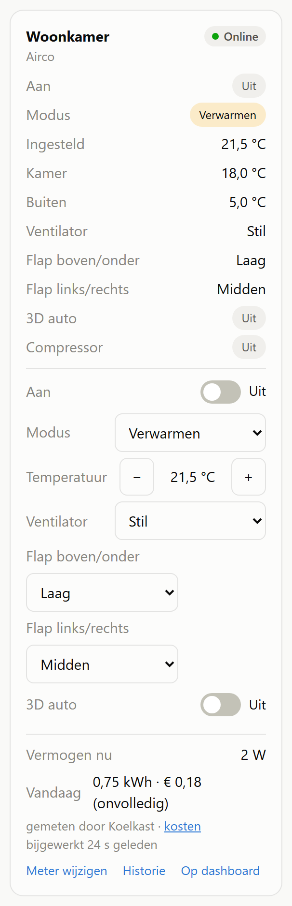

- **De waarden** van het apparaat, met de standen in kleur: oranje voor aan of
  verwarmen, blauw voor koelen.
- **De bediening** (alleen als bediening is toegestaan): aan/uit, modus,
  temperatuur met − en +, ventilator en flappen. De gateway kijkt of het
  apparaat de nieuwe stand overneemt en probeert het anders nog twee keer.
  Daaronder zie je *Bezig…* of *Lukt nog niet, opnieuw proberen (poging 2
  van 3)…*, en in rood als het niet lukte. Dat geldt ook voor de schakelaar
  van een tussenstekker en voor wat een automatisering bedient; geef je zelf
  een nieuwe opdracht, dan gaat die voor.
- **Meter koppelen**: meet een tussenstekker of kWh-meter dit apparaat, koppel
  hem dan. De tegel toont dan het vermogen, het verbruik en de kosten van
  vandaag. Zitten meerdere apparaten op één groep, kies dan bij elk dezelfde
  meter.
- **Historie**: een meetwaarde van de afgelopen 24 uur, naast het vermogen van
  de gekoppelde meter.

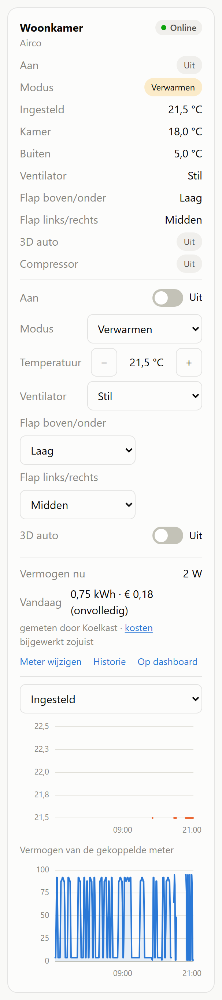

### Thuisbatterij

Heb je Plug-In Batteries, dan stuur je ze aan via de P1-meter. Koppel de
P1-meter eerst via API v2 (Apparaten → **Koppelen**) en voeg dan bij
Instellingen → Plugins *Thuisbatterij (via P1-meter)* toe. Met *Netwerk
scannen* verschijnt de batterij; zet *Bediening toestaan* aan om de stand
te kunnen kiezen.

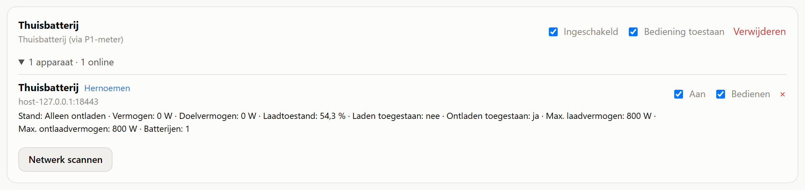

De tegel toont wat de batterijen nu doen: de stand, het vermogen (plus is
laden, min is ontladen), de laadtoestand en of laden en ontladen mogen.
Onderaan kies je de **stand**: *Nul op de meter* (laden bij overschot,
ontladen bij verbruik), *Alleen laden*, *Alleen ontladen*, *Stand-by*,
*Volladen* of *Slim (HomeWizard)*.

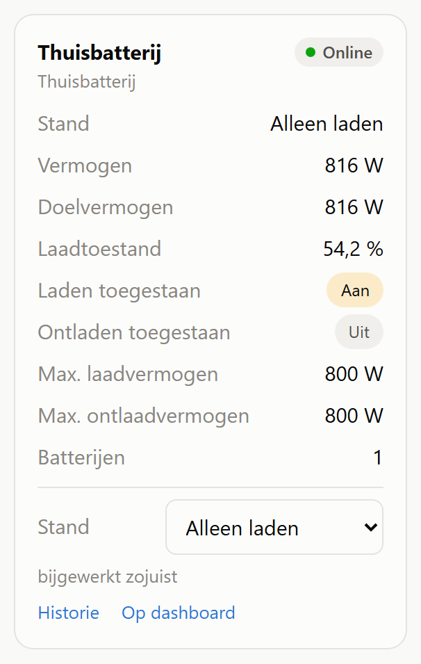
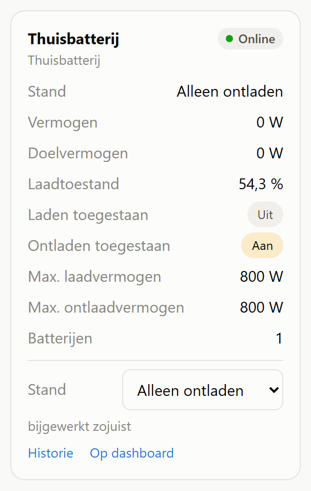

Een automatisering kan de stand ook kiezen. Het voorbeeld *Thuisbatterij
laden bij goedkope stroom* laat de batterij in de vier goedkoopste uren van
de dag alleen laden en zet hem daarna terug op nul op de meter.

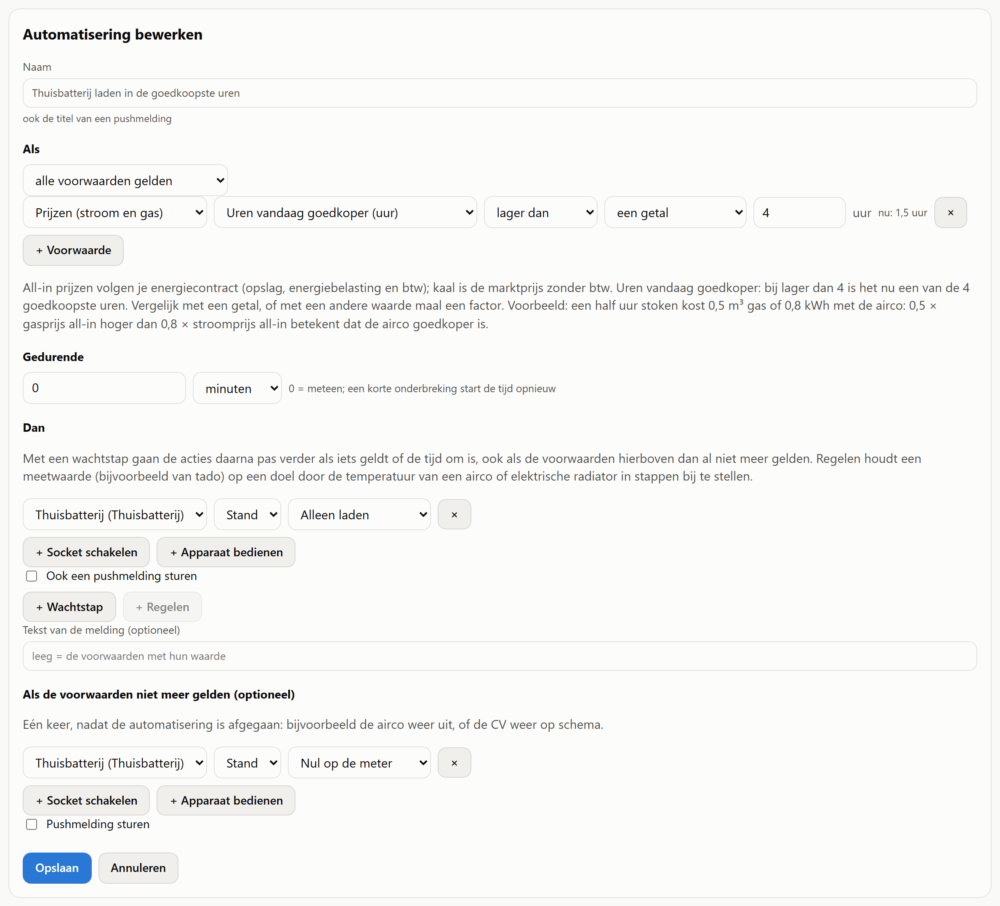

### Dashboardtegel maken

Met **Dashboardtegel maken** bovenaan (of **Op dashboard** bij een apparaat)
maak je een eigen tegel voor het [dashboard](#eigen-tegels-klimaat-apparaten).

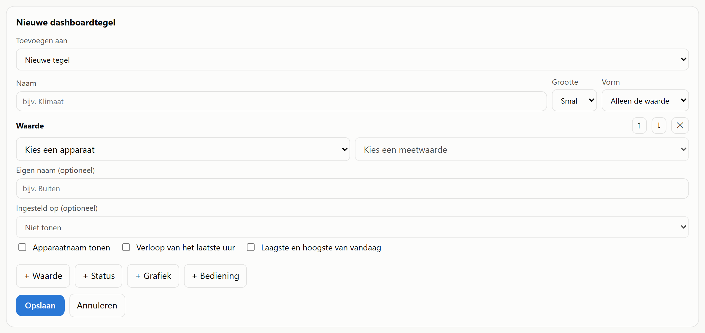

- **Naam**, **Grootte** (*Smal* of *Breed*) en **Vorm**: *Alleen de waarde*,
  *Lijst* (naam links, waarde rechts), *Raster* (twee kolommen), *Eén grote
  waarde* of *Waarde met lijntje* (het verloop van de laatste uren).
- **+ Waarde**: een meetwaarde, eventueel met de naam van het apparaat, het
  verloop van het laatste uur, de laagste en hoogste van vandaag en waarop het
  apparaat is ingesteld.
- **+ Status**: een stand als label, bijvoorbeeld *Verwarmen · ja*.
- **+ Grafiek**: 1 tot 4 meetwaarden over 6 uur, 24 uur of 7 dagen.
- **+ Bediening**: een knop of keuze van het apparaat. Met **Eigen naam**
  geef je de bediening een eigen tekst (bijvoorbeeld *Airco woonkamer* in
  plaats van *Modus*) en met **Apparaatnaam tonen** komt de naam van het
  apparaat erachter (*Modus · Airco woonkamer*), zodat je ziet waar een knop
  bij hoort. Heb je [handmatige acties](#handmatige-acties), dan staan die in
  dezelfde lijst onder *Acties* (*Kies een apparaat of actie*). Een actie
  krijgt een schakelaar of de knop *Uitvoeren*, met eronder wat hij doet
  (bijvoorbeeld *Regelt: …*) en, als hij regelt, het doel met − en +. De
  marge stel je in bij Automatisering.

---

## 10. Instellingen

### Historie, prijsbronnen, beveiliging en toegang

**Historie importeren**: exporteer in de HomeWizard Energy-app je gegevens
per 15 minuten (CSV) en kies hier de bestanden. Je ziet eerst een overzicht;
pas na *Importeren* wordt er iets opgeslagen. Wat er al is, wordt nooit
overschreven, dus hetzelfde bestand twee keer importeren kan geen kwaad. Bij
tussenstekkers en kWh-meters kiest de gateway zelf het apparaat aan de hand
van de tellerstand, of vraagt hij het je.

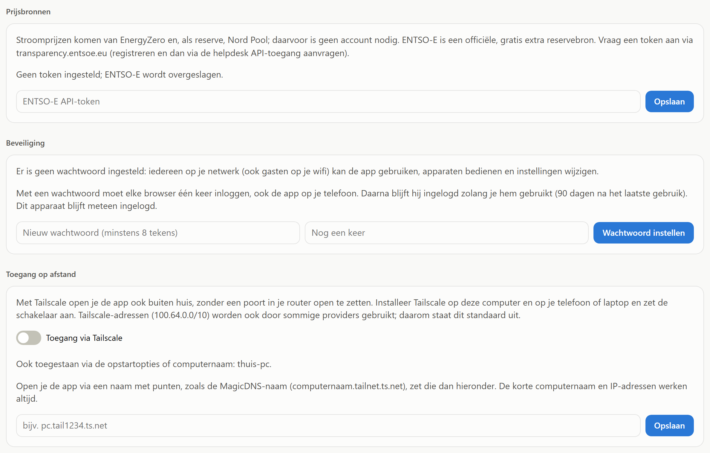

- **Prijsbronnen**: de prijzen komen van EnergyZero en, als reserve, Nord
  Pool; daarvoor is niets nodig. Met een gratis token van ENTSO-E heb je een
  extra, officiële bron.
- **Prognose (geavanceerd)**: de percentages waarmee de prognose van je
  eindafrekening rekent, voor stroom, gas, water en verwarming. Per
  percentage zie je de automatische waarde (berekend uit je metingen of
  standaard) en kun je een eigen waarde invullen; *Automatisch* zet hem
  terug, *Alles automatisch* zet alles terug. Je hoeft hier normaal niets te
  doen.
- **Toegang op afstand**: met *Toegang via Tailscale* open je de app ook
  buiten huis, zonder een poort in je router open te zetten. Met *Tailscale
  Serve* krijgt de app een https-adres in je tailnet (nodig voor installeren
  als app en meldingen): kies de poort en klik **Instellen**; de gateway
  controleert eerst of die poort vrij is.
- **Back-up**: elke nacht maakt de gateway een back-up van je gegevens en
  instellingen. Je ziet hier waar die staat, wanneer de laatste gemaakt is
  en welke bewaard blijven; met *Nu back-up maken* maak je er meteen een.
  Waar de back-ups heen gaan en hoe je er een terugzet, staat in de
  handleiding (*Back-up en terugzetten*).
- **Gateway**: de versie, hoe vaak er wordt uitgelezen en de tijdzone.
- **Beveiliging**: zet een wachtwoord op de app, met sessies per apparaat en
  API-tokens voor andere programma's.

### Rapporten en e-mail

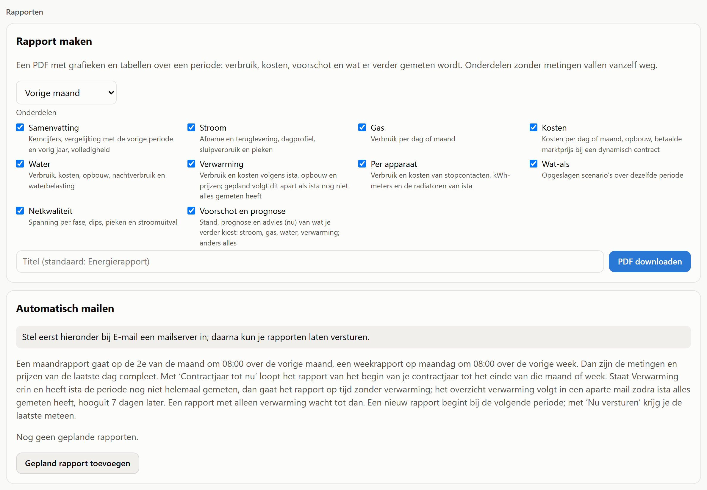

**Rapport maken**: kies een periode (*Vorige maand*, *Deze maand tot nu*,
*Vorige week*, *Contractjaar tot nu*, *Dit jaar tot nu*, *Vorig jaar* of
*Eigen periode*) en de
onderdelen, en klik op *PDF downloaden*. Je krijgt een PDF met grafieken en
tabellen, in dezelfde opmaak voor elk onderdeel: de kerncijfers met de
vergelijking met de vorige periode en vorig jaar en de kosten per onderdeel
met hun contract, stroom (met je dagprofiel, sluipverbruik en hoogste
kwartieren), gas, kosten en hun opbouw (met variabele en vaste kosten
apart), water en verwarming (ista), elk met kosten per dag en hun opbouw,
verbruik en kosten per apparaat (ook per radiator van ista), je
wat-als-scenario's, de netkwaliteit en als laatste het voorschot en de
prognose. De prognose gaat over wat je verder kiest: kies je stroom en gas,
dan zie je geen prognose van water; kies je alleen verwarming, dan alleen
die van verwarming. Kies je niets anders dan de prognose, dan staat alles
erin. Onderdelen zonder metingen vallen vanzelf weg.

**Automatisch mailen**: met *Gepland rapport toevoegen* kies je een naam,
*elke maand* of *elke week*, wat het rapport laat zien (*over die maand of
week*, *contractjaar tot nu* of *kalenderjaar tot nu*), de ontvangers en de
onderdelen. Een
maandrapport komt op de 2e van de maand om 08:00 over de vorige maand, een
weekrapport op maandag om 08:00 over de vorige week, met de kerncijfers in
de mail en het rapport als PDF in de bijlage. *Nu versturen* stuurt de
laatste periode meteen; *Uitzetten* stopt het rapport zonder het weg te
gooien. Staat *Verwarming* erin en heeft ista de periode nog niet helemaal
gemeten (ista loopt vaak een paar dagen achter), dan komt het rapport toch
op tijd, zonder verwarming. De verwarming volgt in een aparte mail zodra
ista alles gemeten heeft, hooguit 7 dagen later; bij het geplande rapport
zie je tot wanneer. Een rapport met alleen verwarming wacht tot dan.

**E-mail**: daarvoor moet de gateway weten via welke mailserver hij
verstuurt. Vul de server, de beveiliging, je gebruikersnaam, het wachtwoord
en de afzender in en stuur een testmail. Bij Gmail gebruik je een
app-wachtwoord; Outlook.com en Microsoft 365 werken niet. Meer in de
[handleiding](HANDLEIDING.md#rapporten-en-e-mail).

### Tabbladen

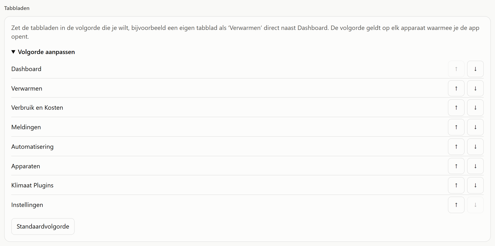

Open *Volgorde aanpassen* en zet de tabbladen in de volgorde die je wilt met ↑ en ↓, bijvoorbeeld een eigen
tabblad *Verwarmen* direct naast *Dashboard*. De volgorde geldt op elke
telefoon en pc; *Standaardvolgorde* zet alles terug.

### Plugins

Naast HomeWizard-apparaten leest de gateway via **plugins** ook andere
apparaten:

| Plugin | Wat | Hoe |
|---|---|---|
| Mitsubishi Heavy (WF-RAC) | airco's met de wifimodule van de Smart M-Air-app | lokaal in je netwerk |
| Tuya / Smart Life | bijvoorbeeld elektrische radiatoren | lokaal; de sleutels haalt de app eenmalig op bij je Tuya IoT-project |
| tado° | kamers van je tado-thermostaat | via de tado-cloud, na eenmalig inloggen |
| ista (verwarming) | verbruik per radiator van mijn.ista.nl | via mijn.ista.nl |

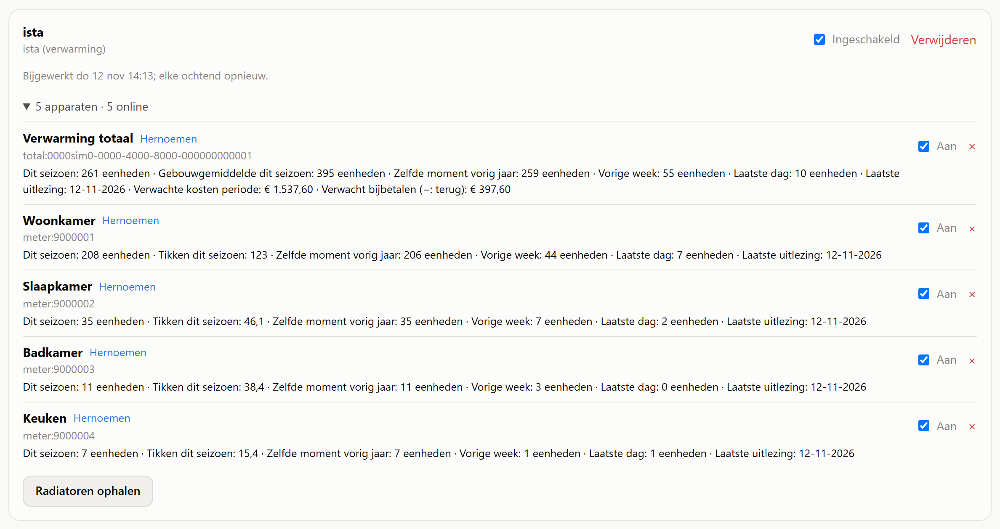

1. Kies onder **Plugin toevoegen** het soort en vul in wat gevraagd wordt; de
   uitleg staat onder elk veld.

   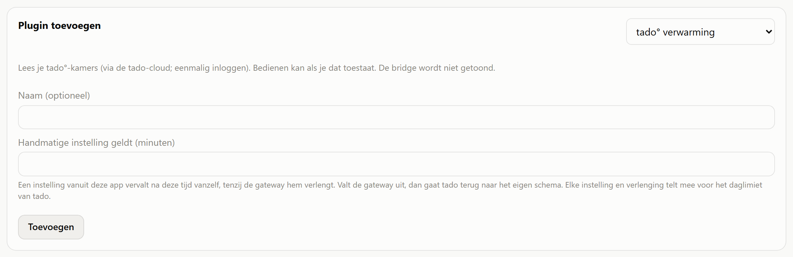

2. Voeg de apparaten toe met **Netwerk scannen** (of *Kamers ophalen*,
   *Radiatoren ophalen*) of **Apparaat handmatig**.
3. **Bediening toestaan** laat de app (en je automatiseringen) het apparaat
   bedienen. Standaard staat dit uit: de app heeft geen login, dus iedereen in
   je netwerk kan dan bedienen. Per apparaat zet je het met *Bedienen* weer
   uit.

### Eigen tabbladen

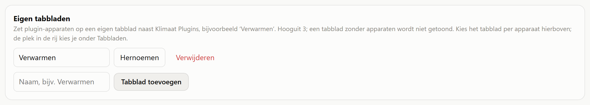

Maak tot drie tabbladen met een eigen naam (bijvoorbeeld *Verwarmen*) en kies
per apparaat op welk tabblad het staat. Apparaten zonder eigen tabblad blijven
op *Klimaat Plugins*. Waar het tabblad in de rij staat kies je onder
[Tabbladen](#tabbladen).

---

## 11. Op je telefoon

De app werkt in elke browser en past zich aan de breedte van je scherm aan.
Installeer hem als app op je beginscherm: in Chrome via *App installeren*, in
Safari via *Deel → Zet op beginscherm*. Voor meldingen en voor gebruik buiten
huis heb je https nodig; zie
[Overal bereikbaar](../README.md#overal-bereikbaar-en-als-app).

  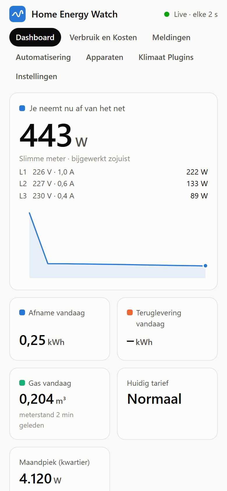
  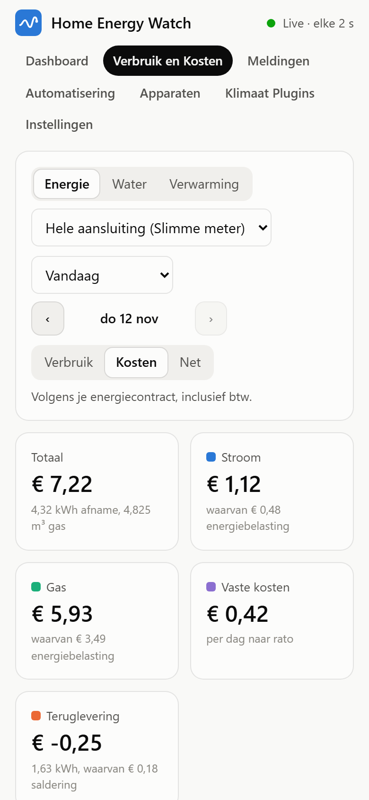
  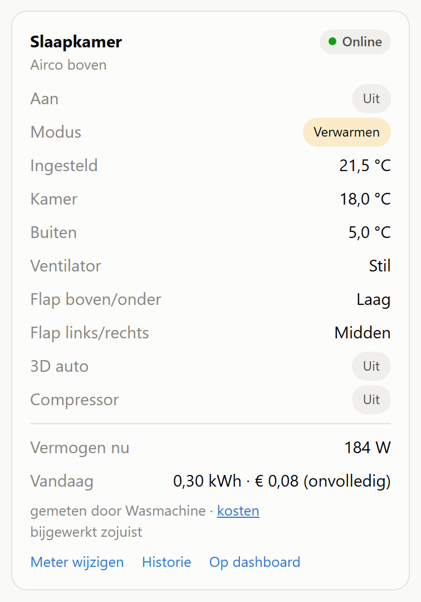

- De tabbladen lopen door over meerdere regels; op de telefoon scrollen ze mee
  weg met de pagina.
- De periode kies je uit een lijst in plaats van met knoppen.
- Formulieren (contracten, meldingen, automatiseringen) staan onder elkaar;
  alles kan op de telefoon, maar een groter scherm is prettiger voor een
  ingewikkelde automatisering.

  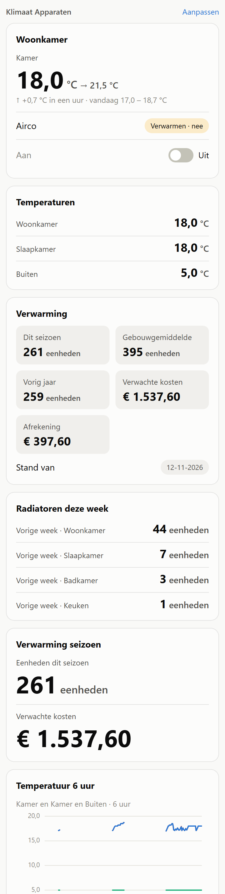
  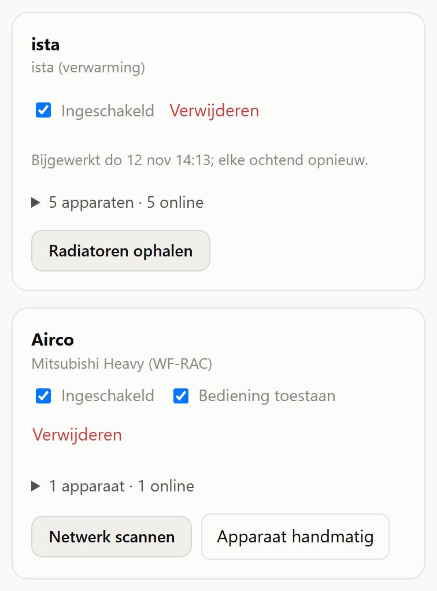

